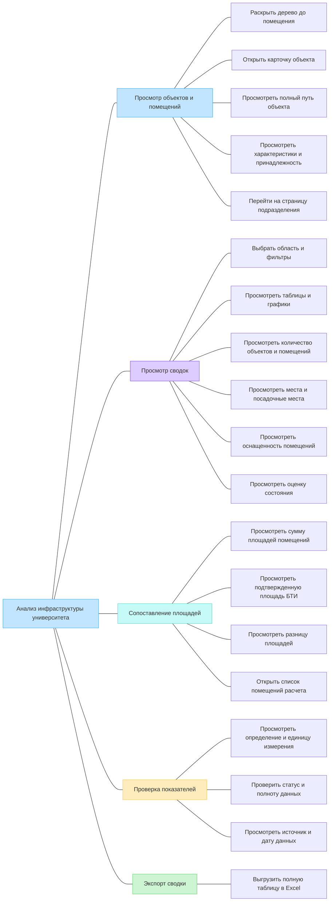
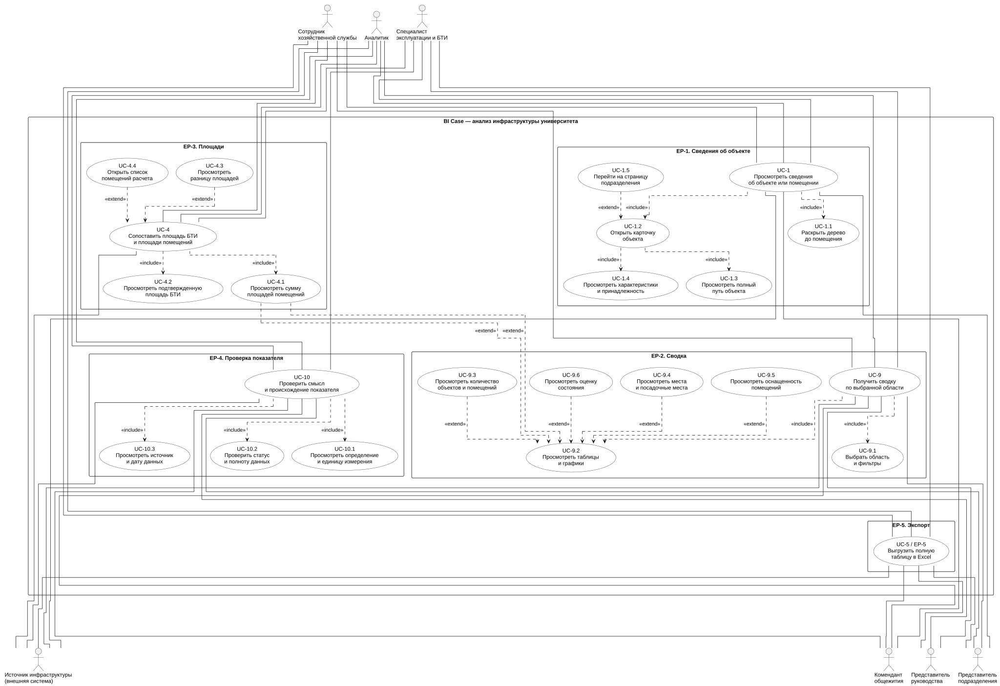
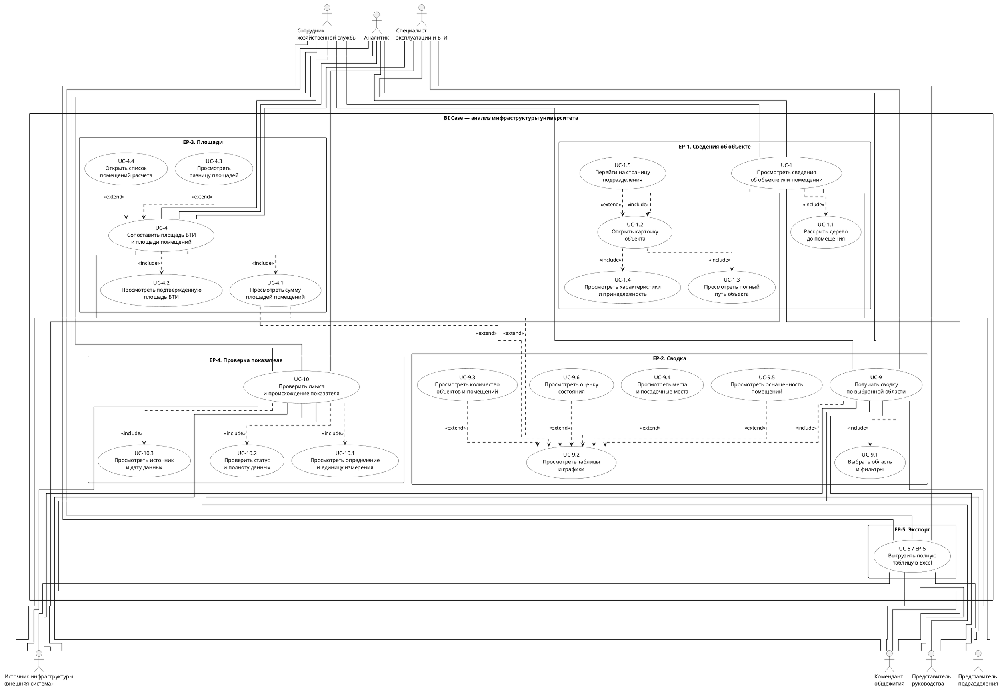
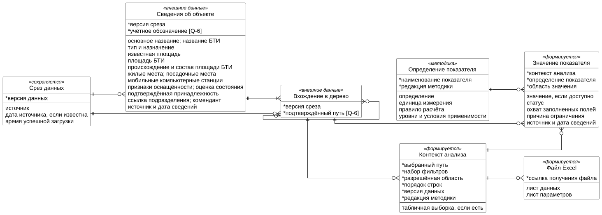
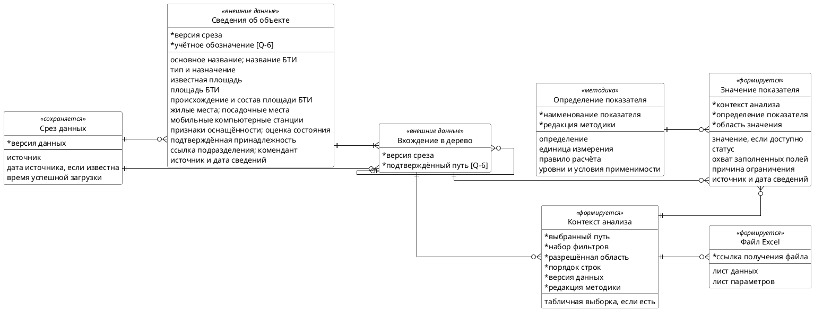

# Документ пользовательских требований

**Кейс:** BI Case — информационная система анализа инфраструктуры университета.  
**Команда:** Луконин Владимир Кириллович, Годенко Алексей Константинович.  
**Дата:** 05.11.2026.  
**Статус:** подготовлены разделы 1–7; командное ревью предстоит.

## 1. Реинжиниринг дерева функций

### 1.1. Основания и границы

Продолжается первый выпуск из лабораторной №1: просмотр инфраструктуры университета, расчёт доступных показателей и экспорт сводок. Бизнес-цели сохраняются:

- **BO-1:** сократить время поиска сведений о помещении не менее чем на 30% в течение месяца после первого выпуска.
- **BO-2:** сократить время подготовки сводки площадей, вместимости и оснащённости не менее чем на 50% за тот же период.
- **BO-3:** обеспечить объяснимость 100% показателей первого выпуска к технической приёмке: определение, единица, область расчёта, источник, статус, полнота и дата источника либо отметка, что она неизвестна.

| Источник | Что использовано |
|----------|------------------|
| [Концепция BI Case](<../../../lab1/variants/BI-Case/case_concept.md>), разделы 2–4 и 6; [RTM](<../../../lab1/variants/BI-Case/RTM.md>) | Цели, роли, функции, сценарии и границы первого выпуска |
| [BI.docx](<../../../archive/research_materials/BI.docx>), блоки 1–3 и 7 | Просмотр помещений, сводки, сопоставление площадей, качество данных и Excel |
| [structure.json](<../../../archive/research_materials/structure.json>) | Фактическая структура исходных данных; вхождения узла в разные ветви не означают разные физические объекты |
| [Методические рекомендации](<../../../archive/research_materials/НАДО СМОТРЕТЬ ПРИЛОЖЕНИ2 !!!Вх_от_Минздрав_России_№0054_от_14_01_2026_О_направлении_Методических.pdf>), приложение №2, страницы 71–72 PDF | Категории площадей, количества помещений и вместимости; показатели загрузки требуют дополнительных данных |
| [Реестр.xlsx](<../../../archive/research_materials/Реестр.xlsx>), листы «ОБЪЕКТЫ», «ПОМЕЩЕНИЯ», «Списки», «Пояснения» | Состав полей и варианты классификации; это форма реестра, а не заполненная инвентаризация |

Приложение №2 присутствует в PDF, хотя в конце `BI.docx` указано обратное. Наличие перечня показателей и полей реестра не подтверждает наличие данных для расчёта. Неизвестные значения не заменяются нулями; ограничения расчётов сохраняются из концепции.

### 1.2. Исходное дерево

Дерево перенесено из раздела 4.2 концепции без изменений.



### 1.3. Сверка с пользовательскими целями

Выделены пять эпиков — законченных целей пользователя. Конечные функции входят в их сценарии и раскрыты подчинёнными прецедентами в разделе 2.

| ID | Пользовательское требование | Узел исходного дерева | Есть в дереве | Что сделано |
|----|-----------------------------|----------------------|---------------|-------------|
| EP-1 | Просмотреть сведения об объекте или помещении | Просмотр объектов и помещений | Да | Ветвь сохранена; навигация, путь, карточка и переход к подразделению входят в одну цель |
| EP-2 | Получить сводку по выбранной области | Просмотр сводок | Да | Ветвь сохранена; фильтры, показатели, таблицы и графики составляют результат одной сводки |
| EP-3 | Сопоставить площадь БТИ и площади помещений | Сопоставление площадей | Да | Ветвь сохранена; список учтённых помещений нужен для проверки сравнения |
| EP-4 | Проверить смысл и происхождение показателя | Проверка показателей | Да | Ветвь сохранена как самостоятельная цель проверки уже показанного значения |
| EP-5 | Выгрузить сводку в Excel | Экспорт сводки | Да | Ветвь сохранена; результат — файл с полной выбранной таблицей и параметрами расчёта |

Связи с первой лабораторной:

| Эпик | Основной инициатор | Бизнес-цель | Основание в концепции |
|------|--------------------|-------------|------------------------|
| EP-1 | Сотрудник хозяйственной службы | BO-1 | FE-1, FE-2; UC-1 |
| EP-2 | Аналитик, представитель руководства | BO-2, BO-3 | FE-3–FE-6; UC-9 |
| EP-3 | Специалист эксплуатации и БТИ | BO-2, BO-3 | FE-3, FE-6; UC-4, BR-9 |
| EP-4 | Аналитик | BO-3 | FE-6; ветвь «Проверка показателей»; UC-10 |
| EP-5 | Аналитик | BO-2, BO-3 | FE-7; UC-5, BR-11 |

Дополнительные роли из концепции используют эти же возможности в пределах своих прав. Представитель подразделения работает с разрешённой областью, комендант — с закреплёнными общежитиями. Аналитик может открыть исходную карточку для проверки сводки; это EP-1.

FE-8 — получение данных через API — обеспечивает выполнение эпиков. Авторизация, проверка прав, загрузка и обновление среза задают общие условия сценариев. Отдельная пользовательская цель управления API или первичным реестром в концепции не заявлена.

### 1.4. Скорректированное дерево

Состав ветвей и листьев сохранён. Названия пяти основных ветвей приведены к целям пользователей и связаны с ID эпиков. Новые функции не добавлены.

```text
Анализ инфраструктуры университета
├── EP-1. Просмотреть сведения об объекте или помещении
│   ├── Раскрыть дерево до помещения
│   ├── Открыть карточку объекта
│   ├── Просмотреть полный путь объекта
│   ├── Просмотреть характеристики и принадлежность
│   └── Перейти на страницу подразделения
├── EP-2. Получить сводку по выбранной области
│   ├── Выбрать область и фильтры
│   ├── Просмотреть таблицы и графики
│   ├── Просмотреть количество объектов и помещений
│   ├── Просмотреть места и посадочные места
│   ├── Просмотреть оснащенность помещений
│   └── Просмотреть оценку состояния
├── EP-3. Сопоставить площадь БТИ и площади помещений
│   ├── Просмотреть сумму площадей помещений
│   ├── Просмотреть подтвержденную площадь БТИ
│   ├── Просмотреть разницу площадей
│   └── Открыть список помещений расчета
├── EP-4. Проверить смысл и происхождение показателя
│   ├── Просмотреть определение и единицу измерения
│   ├── Проверить статус и полноту данных
│   └── Просмотреть источник и дату данных
└── EP-5. Выгрузить сводку в Excel
    └── Выгрузить полную таблицу в Excel
```

Определения и статусы доступны при просмотре сводки и сравнении площадей. EP-4 описывает отдельную цель пользователя — проверить конкретный показатель. Он не дублирует получение сводки EP-2 или сравнение EP-3.

### 1.5. Общие условия и исключения

Во всех эпиках соблюдаются правила BR-1–BR-11 концепции. Существенные условия:

- Учитываются только разрешённые пользователю объекты. Первичные записи не изменяются.
- Один физический объект учитывается в итоге один раз. Поддерживаются ветви разной глубины; отсутствие дочерних узлов само по себе не определяет помещение.
- Подтверждённый ноль, частичные данные, отсутствие данных и неприменимость различаются. Дата загрузки не подменяет дату источника.
- Площадь БТИ и сумма известных площадей помещений показываются раздельно. Разница рассчитывается при сопоставимости данных и не трактуется как свободная площадь.
- Таблица, графики и Excel используют одинаковые фильтры и версию данных. Экспорт охватывает все строки результата, включая строки за пределами текущей страницы.

Пожелания за рамками первого выпуска не получают ID эпиков:

| Пожелание | Решение | Основание в концепции |
|-----------|---------|------------------------|
| Фактическая загрузка всех категорий помещений | Вынесено за рамки: нет необходимых сведений о времени использования, посещениях или занятых местах | Разделы 6.2, 7.5, Q-13 |
| Финансовая эффективность, доходность и коммунальные индексы | Вынесено за рамки: нужны отдельные источники | Раздел 6.2 |
| Редактирование первичных сведений; автоматическое восстановление всех площадей | Вынесено за рамки: не определены ответственность и синхронизация; недостающие площади нельзя достоверно восстановить | Раздел 6.2 |
| Рейтинги цифровой зрелости, гендерная статистика, графики приёма и научные рейтинги | Вынесено за рамки: не относятся к целям первого выпуска или не имеют подтверждённой методики | Раздел 6.2 |
| Историческая динамика, публичный доступ и нативные мобильные приложения | Вынесено за рамки первого выпуска | Разделы 6.2–6.3 |

## 2. Диаграмма вариантов использования

Граница системы — BI Case: просмотр инфраструктуры, расчёт показателей и экспорт. Источник инфраструктуры находится за этой границей и предоставляет данные через API. При работе с сохранённым срезом обращение к нему не требуется.

Пять основных прецедентов соответствуют эпикам. Все 19 конечных функций дерева раскрыты на диаграмме; у экспорта единственная конечная функция совпадает с UC-5. Внутренние рамки группируют прецеденты по эпикам.

Исходник: [diagrams/usecase.puml](diagrams/usecase.puml). [Открыть схему для увеличения](diagrams/usecase.svg).





| Узел скорректированного дерева | Эпик → основной прецедент | Основной актор |
|-------------------------------|--------------------------|----------------|
| Просмотреть сведения об объекте или помещении | EP-1 → UC-1 | Сотрудник хозяйственной службы |
| Получить сводку по выбранной области | EP-2 → UC-9 | Аналитик |
| Сопоставить площадь БТИ и площади помещений | EP-3 → UC-4 | Специалист эксплуатации и БТИ |
| Проверить смысл и происхождение показателя | EP-4 → UC-10 | Аналитик |
| Выгрузить сводку в Excel | EP-5 → UC-5 | Аналитик |

Полный состав акторов приведён в сценариях. Связи показывают участие роли, а конкретные назначения прав уточняются по Q-11 концепции. ИТ-служба и команда разработки не инициируют эти пять пользовательских целей.

`include` направлен от основного прецедента к обязательному действию; `extend` — от условного действия к расширяемому прецеденту. Просмотр значения включает показ его статуса, если значение отсутствует. Все связи изображены без кривых.

### 2.1. Покрытие конечных функций дерева

Для расширений сводки «по профилю» означает, что группа показателей предусмотрена выбранным уровнем. Если группа предусмотрена, но данных недостаточно, она показывается со статусом и причиной ограничения.

| Конечная функция дерева | Прецедент | Связь и условие | Место в сценарии |
|-------------------------|-----------|-----------------|------------------|
| Раскрыть дерево до помещения | UC-1.1 | `include` из UC-1 | UC-1, шаги 1–2 |
| Открыть карточку объекта | UC-1.2 | `include` из UC-1 | UC-1, шаги 3–6 |
| Просмотреть полный путь объекта | UC-1.3 | `include` из UC-1.2 | UC-1, шаг 4 |
| Просмотреть характеристики и принадлежность | UC-1.4 | `include` из UC-1.2 | UC-1, шаг 5 |
| Перейти на страницу подразделения | UC-1.5 | `extend` UC-1.2: пользователь выбрал подтверждённую ссылку | UC-1, третья альтернатива |
| Выбрать область и фильтры | UC-9.1 | `include` из UC-9 | UC-9, шаг 1 |
| Просмотреть таблицы и графики | UC-9.2 | `include` из UC-9 | UC-9, шаги 3–4 |
| Просмотреть количество объектов и помещений | UC-9.3 | `extend` UC-9.2, по профилю | UC-9, шаги 3–4 |
| Просмотреть места и посадочные места | UC-9.4 | `extend` UC-9.2, по профилю | UC-9, шаги 3–4 |
| Просмотреть оснащенность помещений | UC-9.5 | `extend` UC-9.2, по профилю | UC-9, шаги 3–4 |
| Просмотреть оценку состояния | UC-9.6 | `extend` UC-9.2, по профилю | UC-9, шаги 3–4 |
| Просмотреть сумму площадей помещений | UC-4.1 | `include` из UC-4; также `extend` UC-9.2, по профилю | UC-4, шаги 2–3; UC-9, шаги 3–4 |
| Просмотреть подтвержденную площадь БТИ | UC-4.2 | `include` из UC-4 | UC-4, шаги 1 и 3 |
| Просмотреть разницу площадей | UC-4.3 | `extend` UC-4: доступны сопоставимые значения | UC-4, шаг 4 и альтернативы |
| Открыть список помещений расчета | UC-4.4 | `extend` UC-4: пользователь запросил состав расчёта | UC-4, четвёртая альтернатива |
| Просмотреть определение и единицу измерения | UC-10.1 | `include` из UC-10 | UC-10, шаг 3 |
| Проверить статус и полноту данных | UC-10.2 | `include` из UC-10 | UC-10, шаг 4 |
| Просмотреть источник и дату данных | UC-10.3 | `include` из UC-10 | UC-10, шаг 4 |
| Выгрузить полную таблицу в Excel | UC-5 | Основной прецедент EP-5 | UC-5, шаги 1–5 |

Условия расширений отражены в сценариях ниже. Переходы между самостоятельными целями — например, из сводки в экспорт — остаются действиями пользователя и не обозначаются как обязательные включения.

## 3. Эпики

Все требования EP-1–EP-5 имеют уровень эпика. Дополнительный актор всех сценариев — источник инфраструктуры, если данные запрашиваются через API. Номера UC-1, UC-9, UC-4 и UC-5 сохранены из первой лабораторной; UC-10 описывает проверку показателя.

Общие исключения:

- **E-1. Нет доступа.** При каждом чтении и экспорте проверяются текущие права, в том числе для сохранённого среза. При отказе операция не выполняется, закрытые сведения не раскрываются, пользователь видит сообщение об ограничении доступа.
- **E-2. Сбой источника или обновления.** Если доступен ранее успешно загруженный срез, работа продолжается по нему с предупреждением и временем последней успешной загрузки. Дата источника показывается отдельно либо обозначается как неизвестная. Если результат уже открыт, переход на другую версию требует его обновления. Если подходящего среза нет, результат не выдаётся, предлагается повторить запрос. Частично загруженные версии не смешиваются с рабочей.

### EP-1. Просмотреть сведения об объекте или помещении

- **Узел дерева:** «Просмотреть сведения об объекте или помещении».
- **Бизнес-цель:** BO-1.
- **Источник:** хозяйственная служба и специалисты эксплуатации и БТИ; `BI.docx`, блоки 1, 2, 7; концепция FE-1, FE-2, UC-1.
- **Приоритет:** Must — без карточки и пути нельзя выполнить задачу поиска сведений о помещении.

**Пользовательская история.** Как сотрудник хозяйственной службы, я хочу найти объект или помещение в дереве и просмотреть его карточку с полным путём, чтобы проверить характеристики нужного объекта, не перепутав его с одноимённым.

**Сценарий UC-1.**

| Поле | Содержание |
|------|------------|
| Акторы | Основной — сотрудник хозяйственной службы. Также: специалист эксплуатации и БТИ, аналитик, представитель подразделения, комендант общежития |
| Предусловия | Пользователь вошёл в систему. Доступен источник или сохранённый срез; область просмотра ограничена правами |
| Триггер | Пользователь открывает раздел инфраструктуры для поиска сведений об объекте |
| Постусловия успеха | Показаны выбранная карточка, путь её вхождения в дерево и доступные характеристики. Отсутствующие сведения обозначены явно; первичные записи не изменены |
| Постусловия отказа | Запрошенная карточка не показана; причина сообщена без раскрытия закрытых данных |

**Основной поток:**

1. Система показывает доступные группы объектов организации.
2. Пользователь раскрывает нужную ветвь и выбирает объект или помещение (**UC-1.1**).
3. Система проверяет доступ и открывает карточку объекта по одной версии данных (**UC-1.2**).
4. Система показывает основное название, название БТИ при наличии и отличии, а также полный путь выбранного вхождения объекта (**UC-1.3**).
5. Система показывает подтверждённый тип, доступную площадь, характеристики и принадлежность (**UC-1.4**), ссылку на подразделение; для общежития — коменданта при наличии сведений. Доступны источник и дата данных либо отметка, что дата неизвестна.
6. Пользователь просматривает карточку.

**Альтернативы:**

- На шаге 2 выбирается общежитие или клиническая база. Система использует фактическую глубину ветви. При пагинации переход между страницами сохраняет текущий путь.
- На шаге 5 тип не определён или часть полей отсутствует. Доступные сведения показываются, для остальных выводятся «Тип не определён» или «Нет данных». Отсутствие детей не означает тип «помещение».
- После шага 5 пользователь выбирает переход по подтверждённой ссылке на подразделение (**UC-1.5**, расширение UC-1.2). При отсутствии связи система не подбирает её по совпадению названий.

**Исключения:**

- E-1 и E-2 — по общим правилам.
- Выбранный объект удалён или отсутствует в используемой версии: система сообщает о недоступности карточки и предлагает вернуться к доступному родительскому узлу.

### EP-2. Получить сводку по выбранной области

- **Узел дерева:** «Получить сводку по выбранной области».
- **Бизнес-цели:** BO-2, BO-3.
- **Источник:** аналитики, хозяйственная служба и руководство университета; `BI.docx`, блоки 1–3, 7; концепция FE-3–FE-6, UC-9, BR-1, BR-2, BR-5–BR-10.
- **Приоритет:** Must — без сводки показатели приходится собирать вручную, BO-2 не достигается.

**Пользовательская история.** Как аналитик, я хочу получить сводку по выбранной группе объектов и фильтрам с обозначением полноты данных, чтобы подготовить сопоставимые показатели площадей, вместимости и оснащённости.

**Сценарий UC-9.**

| Поле | Содержание |
|------|------------|
| Акторы | Основной — аналитик. Также: сотрудник хозяйственной службы, специалист эксплуатации и БТИ, представитель руководства, представитель подразделения, комендант общежития |
| Предусловия | Пользователь вошёл в систему. Доступны источник или сохранённый срез и разрешённая область просмотра |
| Триггер | Пользователь открывает сводку по выбранному узлу |
| Постусловия успеха | Показана сводка с областью, фильтрами, версией данных, значениями и статусами. Невозможные расчёты сопровождаются причиной; экран не содержит выдуманных нулей |
| Постусловия отказа | Новая сводка не сформирована; причина сообщена. Результат другой области или версии не выдаётся за запрошенный |

**Основной поток:**

1. Пользователь выбирает область: организацию, группу, здание или этаж/блок; задаёт фильтры по типу и подразделению при подтверждённых связях (**UC-9.1**).
2. Система проверяет доступ и определяет разрешённый состав объектов, версию данных, редакцию методики и применимые показатели.
3. По профилю уровня система подготавливает группы: количества уникальных объектов и помещений (**UC-9.3**), суммы известных площадей по категориям (**UC-4.1**), места и посадочные места раздельно (**UC-9.4**), оснащённость, включая мобильные компьютерные станции (**UC-9.5**), и состояние (**UC-9.6**). Действуют правила раздела 4.1 и BR-6–BR-8 концепции; повторное суммирование исключается.
4. Система показывает таблицу и предусмотренные графики (**UC-9.2**), отображает текущую сортировку и позволяет пользователю изменить её. Группы шага 3 расширяют это представление, если входят в профиль уровня. Для значений доступны определение, единица, область расчёта, источник, дата и статус; для частичных данных — охват заполненных полей.
5. Пользователь просматривает результат; изменение фильтров повторяет шаги 2–4 по новому контексту. Изменение сортировки меняет только порядок строк, сохраняя область, фильтры и версии данных и методики.

**Альтернативы:**

- На шаге 2 профиль не предусматривает группу показателей: её расширение UC-9.2 не выполняется. Если тип или состав категории не подтверждён, категорийный расчёт блокируется с объяснением причины. Для отдельного помещения доступны его собственные характеристики через UC-1.
- На шагах 3–4 часть значений отсутствует: показываются известный результат, статус «Частичные данные» и охват. При отсутствии всех значений — «Нет данных»; при неприменимости — «Неприменимо». Подтверждённый ноль сохраняется; пустая категория считается нулевой только при подтверждённом составе.
- На шаге 3 не согласованы шкала состояния, смысл атрибутов или знаменатель процента: соответствующий показатель не рассчитывается, ограничение объясняется.
- На шаге 4 таблица разбита на страницы. Переход между ними не изменяет итог по всей выбранной области. Пользователь может открыть исходную карточку UC-1, сравнение площадей UC-4, пояснение UC-10 или экспорт UC-5.

**Исключения:**

- E-1 и E-2 — по общим правилам.
- Повторы объекта содержат конфликтующие данные без согласованного правила разрешения: затронутый итог не рассчитывается, система объясняет ограничение. Устранение повторов не подменяется произвольным выбором записи.

### EP-3. Сопоставить площадь БТИ и площади помещений

- **Узел дерева:** «Сопоставить площадь БТИ и площади помещений».
- **Бизнес-цели:** BO-2, BO-3.
- **Источник:** специалисты эксплуатации и БТИ, хозяйственная служба; `BI.docx`, блоки 1–3; концепция FE-3, FE-6, UC-4, BR-6, BR-8–BR-10.
- **Приоритет:** Must — без раздельных площадей и условий сравнения пользователь может принять неполную сумму помещений за площадь здания.

**Пользовательская история.** Как специалист эксплуатации и БТИ, я хочу сопоставить подтверждённую площадь БТИ с суммой известных площадей помещений здания и проверить состав расчёта, чтобы выявить расхождение с учётом сопоставимости и полноты данных.

**Сценарий UC-4.**

| Поле | Содержание |
|------|------------|
| Акторы | Основной — специалист эксплуатации и БТИ. Также: сотрудник хозяйственной службы, аналитик |
| Предусловия | Пользователь вошёл в систему и выбрал доступное здание; доступен источник или сохранённый срез |
| Триггер | Пользователь открывает сопоставление площадей здания |
| Постусловия успеха | Площади показаны раздельно. Отображены допустимое расхождение и его ограничения либо причина невозможности сравнения. Доступен состав учтённых помещений |
| Постусловия отказа | Сопоставление не получено из-за ошибки или отказа в доступе; необоснованная разница не показана |

**Основной поток:**

1. Система проверяет доступ и получает площадь БТИ с подтверждением её происхождения и состава (**UC-4.2**), а также помещения здания по одной версии данных. При переходе из сводки сохраняются её фильтры.
2. Система подготавливает сумму валидных площадей уникальных помещений выбранной области с учётом фильтров (**UC-4.1**). Площадь здания и промежуточные итоги этажей в сумму не добавляются.
3. Система показывает площадь БТИ и сумму известных площадей помещений, области учёта обеих площадей, действующие фильтры, источники, даты и полноту данных.
4. Если значения доступны и их состав сопоставим, выполняется **UC-4.3**: система показывает `Δ = SБТИ − Sпомещений`; при положительной площади БТИ — также `Δ% = Δ / SБТИ × 100%`. Расчёт выполняется без промежуточного округления; площади выводятся с двумя знаками после запятой.
5. Система предлагает открыть список помещений расчёта.

**Альтернативы:**

- На шаге 1 площадь БТИ отсутствует или её происхождение не подтверждено: вместо неё показывается «Нет данных», разница не рассчитывается. Обычная площадь из JSON не переименовывается в площадь БТИ.
- На шаге 2 известны площади не всех помещений: сумма и сравнение отмечаются как частичные, рядом выводится охват. Если ни одной валидной площади нет, сумма и разница не рассчитываются, показывается «Нет данных».
- На шаге 4 составы площадей несопоставимы: значения показываются отдельно с пояснением, без разницы. При нулевой площади БТИ относительная разница не рассчитывается.
- После показа площадей пользователь запрашивает состав расчёта (**UC-4.4**, расширение UC-4). Система показывает список помещений, их пути, известную площадь либо статус её отсутствия; для доступного помещения можно открыть UC-1.
- Фильтры исключают часть помещений здания: система сохраняет фильтры и явно показывает состав выборки. Если площадь БТИ для этой области учёта не подтверждена, сравнение не рассчитывается; площадь БТИ всего здания не сравнивается с отфильтрованной суммой.

**Исключения:**

- E-1 и E-2 — по общим правилам.
- Конфликт повторов или неподтверждённый состав помещений препятствует суммированию: затронутый результат не рассчитывается; система показывает причину.

Расхождение само по себе не доказывает ошибку учёта и не означает свободную площадь.

### EP-4. Проверить смысл и происхождение показателя

- **Узел дерева:** «Проверить смысл и происхождение показателя».
- **Бизнес-цель:** BO-3.
- **Источник:** аналитики, руководство и хозяйственная служба; `BI.docx`, блоки 1–3, 7; концепция FE-6, BO-3, BR-8, BR-10.
- **Приоритет:** Must — без определения, источника и статуса нельзя проверить пригодность показателя для анализа.

**Пользовательская история.** Как аналитик, я хочу увидеть определение, источник, область расчёта и полноту конкретного показателя, чтобы определить, можно ли использовать его значение для анализа.

**Сценарий UC-10.**

| Поле | Содержание |
|------|------------|
| Акторы | Основной — аналитик. Также: сотрудник хозяйственной службы, специалист эксплуатации и БТИ, представитель руководства, представитель подразделения, комендант общежития |
| Предусловия | Пользователь вошёл в систему. В карточке UC-1, сводке UC-9 или сравнении UC-4 показан показатель либо его статус; определены версия данных и редакция методики |
| Триггер | Пользователь открывает пояснение выбранного показателя |
| Постусловия успеха | Показаны определение, единица, область и правило расчёта, редакция методики, источник, статус, полнота и дата источника либо отметка о её неизвестности. Пояснение относится к тому же контексту и версии, что и значение |
| Постусловия отказа | Пояснение не получено; причина показана. Описание другого показателя, области или версии не подставлено |

**Основной поток:**

1. Пользователь выбирает показатель для проверки.
2. Система проверяет доступ и получает область, фильтры, версию данных и редакцию методики именно открытого представления.
3. Система показывает определение, единицу измерения, правило расчёта и редакцию методики (**UC-10.1**).
4. Система показывает статус и охват заполненных полей (**UC-10.2**), источник и его дату (**UC-10.3**); время загрузки среза обозначается отдельно.
5. Пользователь сверяет пояснение со значением и ограничениями показателя.

**Альтернативы:**

- На шаге 4 дата источника неизвестна: это указано явно; время загрузки не выдаётся за дату изменения исходных сведений.
- На шаге 4 значение имеет статус «Частичные данные», «Нет данных» или «Неприменимо»: система объясняет причину. Охват заполненных полей не обозначается как доказательство полной инвентаризации.

**Исключения:**

- E-1 и E-2 — по общим правилам.
- Описание показателя или нужная версия пояснения недоступны: система сообщает, что пояснение получить не удалось, и предлагает повторить запрос или обновить исходное представление. Отсутствующее определение не заменяется предположением.

### EP-5. Выгрузить сводку в Excel

- **Узел дерева:** «Выгрузить сводку в Excel».
- **Бизнес-цели:** BO-2, BO-3.
- **Источник:** аналитики, руководство и хозяйственная служба; `BI.docx`, блоки 1, 2, 7; концепция FE-7, UC-5, BR-5, BR-8, BR-10, BR-11.
- **Приоритет:** Must — без Excel пользователь вынужден вручную переносить строки и пояснения для подготовки сводки.

**Пользовательская история.** Как аналитик, я хочу выгрузить полную таблицу текущей сводки в Excel вместе с фильтрами и пояснениями к показателям, чтобы продолжить анализ без ручного переноса и потери контекста.

**Сценарий UC-5.**

| Поле | Содержание |
|------|------------|
| Акторы | Основной — аналитик. Также: сотрудник хозяйственной службы, специалист эксплуатации и БТИ, представитель руководства, представитель подразделения, комендант общежития |
| Предусловия | Пользователь вошёл в систему и открыл табличную сводку. Определены область, фильтры, сортировка, версия данных и редакция методики |
| Триггер | Пользователь выбирает экспорт в Excel |
| Постусловия успеха | Пользователь получил файл со всеми строками разрешённого результата в экранном порядке, с сохранением фильтров, версии данных, редакции методики, значений и статусов; пояснения сохранены |
| Постусловия отказа | Готовый файл не выдан; причина сообщена. Неполная выгрузка не обозначена как успешная |

**Основной поток:**

1. Система повторно проверяет право экспорта и доступ к выбранной области.
2. Система получает все строки результата по тем же фильтрам, сортировке, версии данных и редакции методики, включая строки за пределами текущей страницы.
3. Система формирует лист данных и лист параметров: область, фильтры, версия данных, редакция методики, определения и единицы показателей, статусы, охват и сведения о датах.
4. Известные числовые значения записываются числами, неизвестные — пустыми числовыми ячейками с отдельным статусом. Текст источника не выполняется как формула; реквизиты доступа к источнику не включаются.
5. Пользователь получает ссылку на готовый файл и скачивает его.

**Альтернативы:**

- На шаге 2 строк нет: система сообщает об этом и формирует пустую таблицу с заголовками и листом параметров.
- На шаге 2 источник или методика уже обновились: экспорт использует версию данных и редакцию методики открытой сводки. Если нужный срез или описание методики недоступны, файл не формируется; предлагается обновить сводку и повторить экспорт.

**Исключения:**

- E-1 и E-2 — по общим правилам. Переход на сохранённый срез при экспорте допустим только при совпадении с версией открытой сводки; иначе требуется её обновить.
- Ошибка получения строк или формирования файла: система не выдаёт частичный результат как готовую выгрузку, показывает сообщение и возможность повторить операцию.

## 4. Анализ сущностей и логическая схема данных

Сущности выделены из сценариев раздела 3. Схема описывает данные предметной области, их ключи и связи. Типы полей СУБД, индексы и функциональные точки здесь не определяются.

### 4.1. Сущности и их происхождение

| Сущность | Эпик и источник в сценарии | Что хранит или формирует система | Логический ключ |
|----------|---------------------------|----------------------------------|-----------------|
| Срез данных | Общее исключение E-2; EP-2 и EP-5, постусловия UC-9 и UC-5 | Сохраняет успешно загруженную версию источника и её метаданные; при сбое предыдущая рабочая версия остаётся доступной | Версия данных, показываемая пользователю |
| Сведения об объекте | EP-1, UC-1, шаги 3–5; EP-3, UC-4, шаги 1–3 | Читает внешние названия, тип, площади, вместимость, оснащённость, состояние и принадлежность. Сохраняет их только в составе рабочего среза | Версия среза + подтверждённое учётное обозначение объекта; состав обозначения уточняется по Q-6 |
| Вхождение в дерево | EP-1, UC-1, шаги 1–4 и постусловие полного пути; EP-3, UC-4.4 | Читает внешнюю иерархию и сохраняет её в составе среза. Один объект может иметь несколько вхождений | Версия среза + подтверждённый путь от корня |
| Определение показателя | EP-4, UC-10, шаги 3–4 и постусловие пояснения; NFR-M1 концепции | Хранит согласованные определение, единицу, правило расчёта и условия применимости | Наименование показателя в согласованной методике + редакция методики |
| Контекст анализа | EP-1, выбранный узел UC-1; EP-2, UC-9, шаги 1–2 и постусловия; EP-4 и EP-5, предусловия UC-10 и UC-5 | Формирует параметры текущего просмотра: выбранную область, фильтры, разрешённый состав объектов, порядок строк и используемые версии | Выбранный путь + фильтры + разрешённая область + порядок строк + версии данных и методики |
| Значение показателя | EP-2–EP-4, постусловия UC-9, UC-4 и UC-10 | Формирует значение либо статус его отсутствия, охват, причину ограничения и сведения об источнике | Контекст анализа + определение показателя + область значения |
| Файл Excel | EP-5, UC-5, шаги 3–5 и постусловие успеха | Формирует файл с листом данных и листом параметров для скачивания | Ссылка получения сформированного файла |

**Внешние данные.** «Сведения об объекте» и «Вхождение в дерево» поступают из источника и не редактируются системой. Их локальная копия входит в срез для работы при сбое по E-2 и NFR-R1. Самостоятельный первичный реестр объектов система не ведёт.

**Идентичность объекта.** Учётное обозначение — подтверждённый владельцем данных признак, по которому различаются физические объекты. Его состав и связь с GUID пока не согласованы: это Q-6 и допущение AS-1 концепции. Название и отсутствие дочерних узлов ключом не служат. Подтверждённый путь — цепочка учётных обозначений от корня, отображаемая пользователю полным путём. Сведения об одном объекте в срезе общие для его вхождений; конфликт повторов до согласования правил блокирует затронутые расчёты по UC-9.

**Формируемые данные.** Контекст, значения показателей и файл существуют для выполнения сценария; постоянное хранение истории просмотров и архива Excel не требуется. Редакция методики фиксируется по NFR-M1 для воспроизводимости пояснений и расчётов. Срезы используются для согласованной работы и восстановления после сбоя; историческая аналитика остаётся за рамками первого выпуска.

### 4.2. Логическая схема данных

Исходник: [diagrams/logical-data.puml](diagrams/logical-data.puml). [Открыть схему для увеличения](diagrams/logical-data.svg).





Над разделителем в каждой сущности показаны элементы логического ключа. Пометка «внешние данные» обозначает происхождение сведений; «формируется» — результат обработки в текущем контексте. Назначение и кратность связей приведены ниже.

### 4.3. Связи и кратности

| Связь | Кратность | Основание в сценарии или постусловии |
|-------|-----------|--------------------------------------|
| Срез данных — Сведения об объекте | В срезе 0..* записей; каждая относится ровно к одному срезу | UC-1 показывает сведения одной версии; E-2 допускает сохранённый срез. Отсутствующие объекты не создаются искусственно |
| Срез данных — Вхождение в дерево | В срезе 0..* вхождений; каждое относится ровно к одному срезу | Путь и карточка в постусловии UC-1 согласованы по версии |
| Сведения об объекте — Вхождение в дерево | У записи объекта 1..* вхождений; каждое вхождение указывает ровно на одну запись объекта | Постусловие UC-1 содержит путь выбранного вхождения. BR-1 различает объект и его повторные вхождения |
| Вхождение в дерево — Вхождение в дерево | У вхождения 0..1 родитель и 0..* непосредственных детей | UC-1 раскрывает дерево от корня: у корня родителя нет, остальные узлы имеют одного родителя |
| Вхождение в дерево — Контекст анализа | Одно вхождение может быть выбрано в 0..* контекстах; у контекста ровно один исходный узел | UC-9 и UC-4 выбирают область; UC-1 выбирает карточку. Разные фильтры не создают новый объект инфраструктуры |
| Контекст анализа — Значение показателя | В контексте 0..* значений; каждое относится ровно к одному контексту | Постусловия UC-9 и UC-10 связывают значение с областью, фильтрами и версией. У контекста без применимых показателей значений может не быть |
| Определение показателя — Значение показателя | У определения 0..* значений; у каждого значения ровно одно определение | Постусловие UC-10 требует однозначного смысла и единицы выбранного показателя |
| Вхождение в дерево — Значение показателя | У вхождения 0..* значений; у значения ровно одно вхождение как область расчёта | UC-9 выводит показатели по объектам и уровням; общий итог относится к выбранному узлу, строка по объекту — к соответствующему вхождению |
| Контекст анализа — Файл Excel | На контекст 0..* выгрузок; каждый файл относится ровно к одному контексту | По UC-5 при успехе одной попытки выдан один файл, при отказе — ни одного. Повторные выгрузки допустимы, архив файлов не подразумевается |

Ограничения согласованности:

- Сведения об объекте, его вхождения, выбранная область и области значений относятся к одному срезу. Родительские связи не образуют циклов и не переходят между версиями.
- Значение использует редакцию определения из своего контекста. Карточка или сводка, пояснение и Excel сохраняют одинаковые параметры; права проверяются заново при обращении.
- Число может отсутствовать, но статус и причина ограничения сохраняются. «Нет данных», «Частичные данные», «Неприменимо» и подтверждённый ноль различаются; дата загрузки не подменяет дату источника.
- Состав табличной выборки выводится из выбранного узла, фильтров и разрешённой области. При подсчёте используется идентичность объектов, а не число их вхождений.

### 4.4. Что не выделено в отдельные сущности

| Слово из сценариев | Классификация и решение |
|-------------------|------------------------|
| Аналитик, сотрудник, представитель руководства, комендант как роль | Акторы. Учётные записи и администрирование ролей в этих сценариях не создаются |
| Источник инфраструктуры как система, API, сервис формирования Excel | Участники или механизмы обработки. Название источника и дата сведений — атрибуты среза и значения |
| Подразделение, его ссылка, сведения о коменданте | Подтверждённые атрибуты сведений об объекте. Правила принадлежности, включая нескольких владельцев, остаются вопросом Q-8; неподтверждённая кратность отдельной связи не назначается |
| Площадь помещения и БТИ, места, оборудование, оценка состояния | Исходные атрибуты сведений об объекте. Суммы, доли и расхождение — экземпляры «Значения показателя» по своему определению |
| Определение, единица, формула, статус, охват, дата | Атрибуты соответствующих сущностей; отдельные справочники статусов и единиц сценариями не требуются |
| Путь, фильтры, сортировка | Путь входит в ключ вхождения; фильтры и сортировка — в параметры контекста |
| Карточка, сводка, таблица, строки и графики | Формы представления данных в контексте анализа. Строки относятся к формируемой выборке; отдельный реестр отчётов не создаётся |
| Пагинация, проверка доступа, обновление, сбой источника | Управление просмотром, правила и исключения; новых сущностей предметной области не добавляют |
| Загрузка по времени, финансовые показатели, историческая динамика | Вне рамок первого выпуска по разделу 1.5; данных для них на схеме нет |

## 5. Проверка требований

Проверен набор EP-1–EP-5: истории и сценарии раздела 3, покрытие 19 конечных функций и логическая схема из семи сущностей. Проверка относится к документу; результаты испытаний реализации здесь не фиксируются. Дата проверки — 06.11.2026.

### 5.1. Подготовка

Распределение ролей для командного ревью предлагается ниже. Фактически выполнены обсуждение с автором работы, самопроверка с Codex и проверка согласованности файлов. Напарник и преподаватель эту редакцию ещё не проверяли — автор подтвердил это в переписке.

| Роль | Участник | Участие |
|------|----------|---------|
| Аналитик | Луконин Владимир Кириллович | Авторская проверка и замечания в переписке; подготовка с Codex |
| Заказчик, учебная роль | Преподаватель | Ревью предстоит; фактическое участие не записано |
| Разработчик | Годенко Алексей Константинович — предлагается | Участие в командном ревью нужно подтвердить |
| Тестировщик | Луконин Владимир Кириллович — предлагается | Чек-лист подготовлен с Codex; командная проверка предстоит |

Объект проверки — пять эпиков из раздела 3; ID и состав не менялись. Чек-лист заполнен в разделе 6. Источники и бизнес-цели сверены с концепцией и RTM первой лабораторной.

### 5.2. Полнота

| ID | Роль | Действие | Ценность | Контекст | Результат |
|----|------|----------|----------|----------|-----------|
| EP-1 | Сотрудник хозяйственной службы | Найти объект и просмотреть карточку | Проверить нужный объект без путаницы названий | Вход в систему, разрешённая область, источник или срез | Полное |
| EP-2 | Аналитик | Получить сводку по области и фильтрам | Подготовить сопоставимые показатели | Выбран узел, определены права, версии данных и методики | Полное |
| EP-3 | Специалист эксплуатации и БТИ | Сопоставить площади и проверить состав | Выявить расхождение с учётом ограничений | Выбрано здание; доступность и сопоставимость площадей проверяются в сценарии | Полное |
| EP-4 | Аналитик | Проверить определение, источник и полноту показателя | Оценить пригодность значения для анализа | Показатель или его статус уже представлен в определённом контексте | Полное |
| EP-5 | Аналитик | Получить таблицу и параметры в Excel | Продолжить анализ без ручного переноса | Открыта таблица, зафиксированы область, фильтры, порядок строк и версии | Полное |

Историй без роли, действия или ценности не выявлено. Недостающие уточнения параметров найдены в сценариях и исправлены по разделам 5.3–5.4.

### 5.3. Однозначность и проверяемость

| Исходный фрагмент | Проблема | Уточнение и способ проверки |
|------------------|----------|-----------------------------|
| UC-5 требует определённую сортировку, но UC-9 её не задаёт | Неясно, какой порядок должен попасть в Excel | UC-9 показывает текущую сортировку и позволяет её изменить. Проверка: порядок в полном файле соответствует порядку выбранной таблицы; AC-8 |
| UC-10 и UC-5 используют слово «версия» при наличии версий данных и методики | Можно ошибочно взять актуальную методику вместо использованной в открытом результате | Предусловия и потоки явно фиксируют обе версии; при недоступности нужной редакции результат не подменяется. Проверка: пояснение и Excel соответствуют открытой сводке; AC-8, AC-13 |
| Истории EP-1–EP-5 | Размытых нормативных слов «быстро», «удобно», «надёжно», «оперативно» не выявлено | Формулировки историй сохранены; проверяются наблюдаемые постусловия и критерии концепции |

Проверяемые результаты: карточка и путь — AC-1, AC-2; расчёты и статусы — AC-3–AC-7; пояснение показателя — AC-13; полный Excel — AC-8, AC-9. Новые численные пороги не вводились. Цели BO-1 и BO-2 измеряются после выпуска по методике концепции, а не фактом наличия экранов.

### 5.4. Непротиворечивость

Сопоставлены все десять пар: эпики используют общие данные, роли или версию источника.

| Пара эпиков | Проверяемый вопрос | Результат и принятое правило |
|-------------|--------------------|------------------------------|
| EP-1 / EP-2 | Повторное вхождение объекта может увеличить итог | Карточка использует выбранный путь; расчёт — уникальность объектов по BR-1. Конфликтующих дублей не суммируют |
| EP-1 / EP-3 | Обычная площадь может быть выдана за БТИ | Сравнение использует только подтверждённую площадь БТИ; её происхождение проверяется отдельно |
| EP-1 / EP-4 | В карточке и пояснении могут оказаться разные сведения | Один контекст и версии; неизвестная дата не заменяется датой загрузки |
| EP-1 / EP-5 | Право просмотра может ошибочно считаться правом экспорта | UC-5 требует открытой таблицы и повторной проверки права экспорта; E-1 |
| EP-2 / EP-3 | Фильтры сводки исключают часть помещений, а БТИ относится ко всему зданию | Уточнён UC-4: фильтры сохраняются и показываются. Без подтверждения сопоставимого состава разница не рассчитывается |
| EP-2 / EP-4 | Значение и пояснение могут использовать разные методики | UC-10 использует редакцию методики именно открытого представления; при недоступности выдаётся отказ |
| EP-2 / EP-5 | Пагинация, порядок строк или обновление источника меняют выгрузку | Выгружается полный результат с экранными фильтрами, сортировкой и версиями, а не одна страница |
| EP-3 / EP-4 | Частичная сумма выглядит окончательным расхождением | Статус, охват и ограничения сохраняются в значении и пояснении; BR-8, BR-9 |
| EP-3 / EP-5 | При выгрузке могут потеряться ограничения площадей | В табличной выгрузке сохраняются значения, статусы, область и параметры расчёта; неподтверждённая разница не добавляется |
| EP-4 / EP-5 | В Excel может попасть новое определение показателя | Файл использует определения из той же редакции методики, что и открытый контекст |

После уточнений противоречий между заявленными правилами эпиков не выявлено. Неутверждённые правила источника остаются открытыми зависимостями в разделе 5.10.

### 5.5. Атомарность

| Эпик | Проверенная формулировка | Решение |
|------|-------------------------|---------|
| EP-1 | Найти объект и просмотреть его сведения | Одна цель — получить сведения о конкретном объекте; навигация и карточка являются её шагами |
| EP-2 | Получить сводку с разными группами показателей | Один результат по общему контексту. Группы показателей показаны подчинёнными прецедентами, применяемыми по профилю |
| EP-3 | Сопоставить площади и проверить состав расчёта | Список помещений объясняет сравнение и открывается условно; самостоятельной цели учёта помещений не добавлено |
| EP-4 | Увидеть определение, источник и полноту | Одна цель — понять конкретный показатель; перечислены сведения, необходимые для неё |
| EP-5 | Получить таблицу и параметры в Excel | Один файл и одна цель; листы данных и параметров не становятся отдельными эпиками |

Состав EP-1–EP-5 сохранён. Эпики не дробились до полей карточки; разделённых или заменённых ID нет.

### 5.6. Трассируемость

| ID | Требование / узел дерева | Источник | Бизнес-цель | Функции концепции | Прецеденты | Приёмка из концепции | Статус |
|----|--------------------------|----------|-------------|------------------|------------|----------------------|--------|
| EP-1 | Просмотреть сведения об объекте или помещении | Хозяйственная служба, специалисты эксплуатации и БТИ | BO-1 | FE-1, FE-2, FE-8 | UC-1; UC-1.1–UC-1.5 | AC-1, AC-2, AC-9 | Связи проверены |
| EP-2 | Получить сводку по выбранной области | Аналитики, руководство, хозяйственная служба | BO-2, BO-3 | FE-3, FE-4, FE-5, FE-6, FE-8 | UC-9; UC-9.1–UC-9.6; общий UC-4.1 | AC-3, AC-4, AC-5, AC-7, AC-14 | Связи проверены |
| EP-3 | Сопоставить площадь БТИ и площади помещений | Специалисты эксплуатации и БТИ, хозяйственная служба | BO-2, BO-3 | FE-3, FE-6, FE-8 | UC-4; UC-4.1–UC-4.4 | AC-3, AC-5, AC-6 | Связи проверены |
| EP-4 | Проверить смысл и происхождение показателя | Аналитики, руководство, хозяйственная служба | BO-3 | FE-6, FE-8 | UC-10; UC-10.1–UC-10.3 | AC-13 | Связи проверены |
| EP-5 | Выгрузить сводку в Excel | Аналитики, руководство, хозяйственная служба | BO-2, BO-3 | FE-7, FE-8 | UC-5 | AC-8, AC-9 | Связи проверены |

UC-10 детализирует существующие BO-3 и FE-6; новой бизнес-цели не вводит. Общие права и работа со срезом проверяются по E-1, E-2 и AC-9, AC-10. «Связи проверены» означает согласованность документов, а не выполненную приёмку реализации.

### 5.7. Приоритеты

| ID | Приоритет MoSCoW | Обоснование |
|----|-----------------|-------------|
| EP-1 | Must | Без карточки и пути не выполняется задача поиска сведений BO-1 |
| EP-2 | Must | Без сводки сохраняется ручное сведение показателей, BO-2 не достигается |
| EP-3 | Must | Без раздельных площадей и условий сравнения нельзя корректно интерпретировать расхождение |
| EP-4 | Must | Без определения, источника и полноты нельзя обеспечить BO-3 |
| EP-5 | Must | Без Excel результат приходится вручную переносить для дальнейшего анализа |

Must относится к цели эпика в первом выпуске. Дополнительные графики можно отложить по разделу 7.3 концепции; отсутствие данных требует корректного статуса, а не выдуманного расчёта. Полезность пилота на реальных данных отдельно проверяется по AC-14.

### 5.8. Ревью и обратная связь

Фактическая обратная связь получена от автора работы в этой переписке. Это авторское обсуждение; ревью с напарником, преподавателем и пользователями университета ещё не проводилось. Его результаты должны быть добавлены после проведения, с автором замечания и решением.

| Замечание или вопрос | Кто высказал | Решение | Результат |
|---------------------|--------------|---------|-----------|
| На диаграмме нужно учесть каждую конечную функцию | Автор работы, переписка с Codex | Принято | EP-1–EP-5: все 19 функций представлены в схеме и таблице 2.1 |
| Связи должны быть прямыми, без кривых | Автор работы, переписка с Codex | Принято | Диаграмма прецедентов и схема данных отрисованы прямыми отрезками |
| Нужно ли развернуть `include` от UC-10.1 и UC-10.2 к UC-10? | Автор работы, переписка с Codex | Проверено; изменение не требуется | Сохранено UC-10 → UC-10.1/UC-10.2/UC-10.3: основная цель включает эти действия; [правило UML](https://issues.omg.org/issues/UML25-429) |

Открытый этап: пройти диаграмму и сценарии с участниками командного ревью из раздела 5.1. Утверждение заказчиком и одобрение напарником в этом документе не заявлены.

### 5.9. Разбор с помощью ИИ

**Инструмент:** Codex, самопроверка текущей моделью в этой сессии, 06.11.2026. Входная редакция — коммит `7c846b9`, до исправлений этой проверки. Это разбор текста требований, а не независимое ревью другим участником команды.

**Промпт:**

```text
Проанализируй пользовательские требования BI Case на неполноту, неоднозначность, противоречия, дубли и нарушение атомарности. Проверь согласованность историй, сценариев, параметров расчёта и логической схемы. Для замечаний укажи эпик, место и конкретное исправление. Учитывай общие исключения и ссылки на бизнес-правила: не называй дефектом уже описанную обработку. Не расширяй границы первого выпуска и не считай открытые вопросы заказчику согласованными.

Вход: документ пользовательских требований из коммита 7c846b9, разделы 3–4; связанные правила и вопросы концепции из первой лабораторной. Проверяемые истории:

EP-1. Просмотреть сведения об объекте или помещении
Как сотрудник хозяйственной службы, я хочу найти объект или помещение в дереве и просмотреть его карточку с полным путём, чтобы проверить характеристики нужного объекта, не перепутав его с одноимённым.

EP-2. Получить сводку по выбранной области
Как аналитик, я хочу получить сводку по выбранной группе объектов и фильтрам с обозначением полноты данных, чтобы подготовить сопоставимые показатели площадей, вместимости и оснащённости.

EP-3. Сопоставить площадь БТИ и площади помещений
Как специалист эксплуатации и БТИ, я хочу сопоставить подтверждённую площадь БТИ с суммой известных площадей помещений здания и проверить состав расчёта, чтобы выявить расхождение с учётом сопоставимости и полноты данных.

EP-4. Проверить смысл и происхождение показателя
Как аналитик, я хочу увидеть определение, источник, область расчёта и полноту конкретного показателя, чтобы определить, можно ли использовать его значение для анализа.

EP-5. Выгрузить сводку в Excel
Как аналитик, я хочу выгрузить полную таблицу текущей сводки в Excel вместе с фильтрами и пояснениями к показателям, чтобы продолжить анализ без ручного переноса и потери контекста.
```

**Ответ модели:**

```text
Самопроверка текущей моделью дала пять замечаний:

1. В UC-1 альтернатива отсутствующего типа ссылается на шаг 4, хотя тип выводится на шаге 5.
2. В UC-5 требуется сортировка, но UC-9 не описывает её задание и фиксацию.
3. При переходе из отфильтрованной сводки в UC-4 нужно явно сохранить фильтры и проверить сопоставимость площади БТИ с полученной выборкой.
4. В UC-10 и UC-5 стоит явно закрепить редакцию методики открытого представления.
5. Открытые вопросы к владельцу данных и фактическое ревью нельзя отмечать как подтверждённые.

Роль, действие и ценность есть во всех пяти историях. Новых эпиков для исправлений не требуется.
```

Обработка замечаний:

| ID | Замечание | Тип | Решение | Куда внесено |
|----|-----------|-----|---------|--------------|
| AI-1 | Альтернатива типа привязана не к тому шагу | Непротиворечивость сценария | Принято | EP-1, UC-1: ссылка изменена с шага 4 на шаг 5 |
| AI-2 | В UC-9 не определена сортировка для UC-5 | Неполнота | Принято | EP-2, UC-9, шаги 4–5: задание и сохранение порядка строк |
| AI-3 | Неясен переход фильтров из сводки в сравнение площадей | Неоднозначность области расчёта | Принято | EP-3, UC-4, шаги 1–3 и пятая альтернатива: сохранение фильтров и запрет несопоставимой разницы |
| AI-4 | Недостаточно явная фиксация редакции методики | Неоднозначность версии | Принято | EP-4, UC-10, предусловия и шаг 2; EP-5, UC-5, предусловия, поток и альтернатива обновления |
| AI-5 | Нельзя считать внешние зависимости и ревью подтверждёнными | Открытые зависимости | Принято | Разделы 5.1, 5.8, 5.10 и строка 11 чек-листа |

Все пять замечаний приняты в обработку; отклонённых замечаний модели в этом разборе нет. Формулировки историй и число эпиков сохранены.

### 5.10. Протокол дефектов и открытых вопросов

История включает исправления предыдущих редакций, выполненные по обратной связи автора, и исправления текущей проверки.

| ID | Эпик / место | Дефект | Тип | Исправление | Статус |
|----|--------------|--------|-----|-------------|--------|
| D-1 | EP-1–EP-5, первоначальная диаграмма | Пять крупных целей не показывали явно все конечные функции | Неполнота покрытия | Добавлены подчинённые прецеденты и таблица покрытия 19 функций | Исправлено ранее |
| D-2 | Диаграммы | Кривые связи не соответствовали уточнению автора | Оформление | Связи выполнены прямыми отрезками | Исправлено ранее |
| D-3 | EP-1, UC-1 | Отсутствующий тип привязан к шагу 4 вместо шага 5 | Несогласованность ссылки | Исправлена ссылка в альтернативе; AI-1 | Исправлено |
| D-4 | EP-2 / EP-5 | Сортировка требуется для экспорта, но не задаётся при просмотре | Неполнота | Уточнены шаги 4–5 UC-9; AI-2 | Исправлено |
| D-5 | EP-2 / EP-3 | Фильтры при переходе к сравнению площадей описаны неявно | Неоднозначность области | Уточнены UC-4 и условие сопоставимости; AI-3 | Исправлено |
| D-6 | EP-4 / EP-5 | Слова о версии допускают неявную подмену редакции методики | Неоднозначность | Явно зафиксированы версии открытого контекста; AI-4 | Исправлено |

Открытые зависимости из концепции не закрыты редактурой документа:

| Вопросы концепции | Что подтвердить | Кому адресовано | Затронутые эпики |
|------------------|-----------------|-----------------|------------------|
| Q-2, Q-3, Q-6, Q-8 | Классификацию, служебные значения, идентичность и принадлежность объектов | Владелец данных, хозяйственная служба, ИТ-служба | EP-1–EP-5 |
| Q-4, Q-10 | Происхождение и состав БТИ, полноту инвентаризации и контрольную выборку | Эксплуатация и БТИ, хозяйственная служба, аналитик | EP-2, EP-3 |
| Q-1, Q-9, Q-12 | Состав показателей, шкалу состояния и смысл вместимости | Заказчик, аналитик, владелец данных | EP-2, EP-4 |
| Q-5, Q-7, Q-11 | Обновление, работу с версиями, контракт API и права доступа | Владелец источника, ИТ-служба, руководитель проекта | EP-1–EP-5 |

До ответов действуют ограничения и альтернативы сценариев. Полная реализуемость расчётной части и результат приёмки на реальных данных не подтверждены. Командное ревью из раздела 5.8 также остаётся открытым.

## 6. Чек-лист по каждому эпику

«Да» относится к качеству текущей формулировки и её связям. Проверка реализуемости по всем условиям источника остаётся открытой.

| № | Критерий | EP-1 | EP-2 | EP-3 | EP-4 | EP-5 | Комментарий |
|---|----------|------|------|------|------|------|-------------|
| 1 | Указана роль пользователя | Да | Да | Да | Да | Да | Роли есть в историях и сценариях |
| 2 | Указано действие | Да | Да | Да | Да | Да | Соответствует цели эпика |
| 3 | Указана ценность | Да | Да | Да | Да | Да | Связана с BO-1–BO-3 |
| 4 | Требование однозначно | Да | Да | Да | Да | Да | Уточнены область, сортировка и версии; неопределённые правила источника выделены явно |
| 5 | Требование проверяемо | Да | Да | Да | Да | Да | Есть наблюдаемые постусловия и ссылки на AC |
| 6 | Требование атомарно | Да | Да | Да | Да | Да | Одна пользовательская цель на эпик; раздел 5.5 |
| 7 | Не противоречит другим | Да | Да | Да | Да | Да | Проверены десять пар; раздел 5.4 |
| 8 | Имеет уникальный ID | Да | Да | Да | Да | Да | EP-1–EP-5 и согласованные номера UC |
| 9 | Указан источник | Да | Да | Да | Да | Да | Стейкхолдеры и материалы перечислены в разделах 1, 3, 5.6 |
| 10 | Указан приоритет | Да | Да | Да | Да | Да | Must с обоснованием для каждого эпика |
| 11 | Реализуемость полностью подтверждена | Нет* | Нет* | Нет* | Нет* | Нет* | Открыты вопросы об источнике, методике, доступе и версиях; раздел 5.10 |
| 12 | Требование актуально | Да | Да | Да | Да | Да | Сохраняет цели и границы первого выпуска концепции |

`Нет*` означает отсутствие полного подтверждения внешних условий, а не доказанную невозможность реализации. Корректное сообщение об ограничении обязательно уже в первом выпуске. Утверждение набора после командного ревью фиксируется отдельно.

## 7. Актуальный перечень после проверки

Действующие истории и полные сценарии находятся в разделе 3 и уже содержат принятые исправления. Таблица фиксирует итоговый состав без повторного копирования сценариев.

| ID | Актуальное пользовательское требование | Сценарий | Результат проверки |
|----|---------------------------------------|----------|--------------------|
| EP-1 | Просмотреть сведения об объекте или помещении | UC-1; UC-1.1–UC-1.5 | Сохранено; исправлена привязка альтернативы |
| EP-2 | Получить сводку по выбранной области | UC-9; UC-9.1–UC-9.6 | Сохранено; уточнены сортировка и параметры контекста |
| EP-3 | Сопоставить площадь БТИ и площади помещений | UC-4; UC-4.1–UC-4.4 | Сохранено; явно описаны фильтры и сопоставимость |
| EP-4 | Проверить смысл и происхождение показателя | UC-10; UC-10.1–UC-10.3 | Сохранено; закреплена редакция методики открытого представления |
| EP-5 | Выгрузить сводку в Excel | UC-5 | Сохранено; обе версии и порядок строк согласованы с экраном |

Все 19 конечных функций покрыты в разделе 2.1. Новые эпики и бизнес-цели не добавлены; исходное дерево и состав логической схемы сохранены. Итоговая редакция подготовлена к командному ревью; открытые зависимости перечислены в разделе 5.10.
