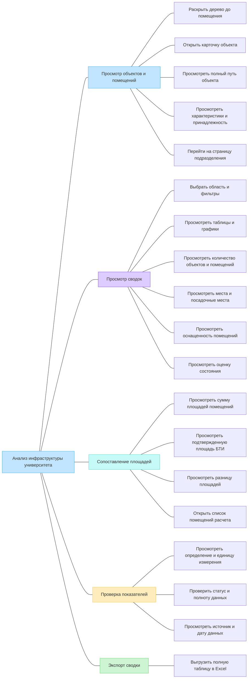
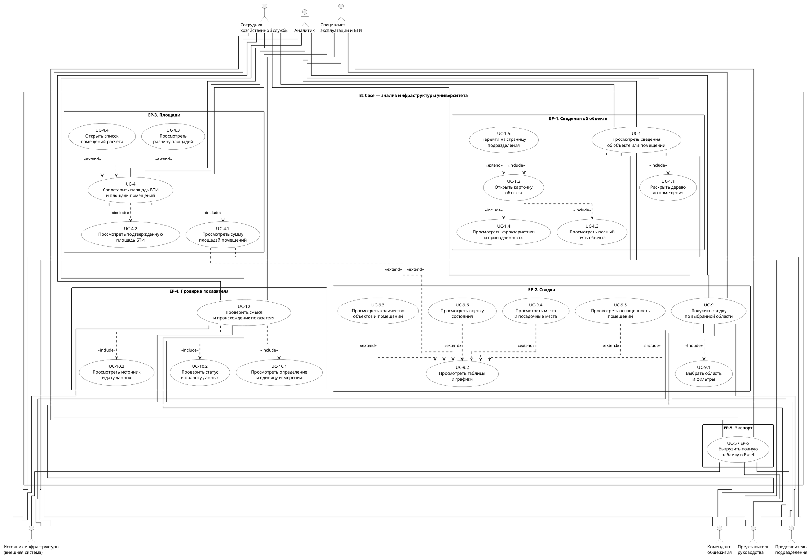

# Документ пользовательских требований

**Кейс:** BI Case — информационная система анализа инфраструктуры университета.  
**Команда:** Луконин Владимир Кириллович, Годенко Алексей Константинович.  
**Дата:** 05.11.2026.  
**Статус:** подготовлены разделы 1–3.

## 1. Реинжиниринг дерева функций

### 1.1. Основания и границы

Продолжается первый выпуск из лабораторной №1: просмотр инфраструктуры университета, расчёт доступных показателей и экспорт сводок. Бизнес-цели сохраняются:

- **BO-1:** сократить время поиска сведений о помещении не менее чем на 30% в течение месяца после первого выпуска.
- **BO-2:** сократить время подготовки сводки площадей, вместимости и оснащённости не менее чем на 50% за тот же период.
- **BO-3:** обеспечить объяснимость 100% показателей первого выпуска к технической приёмке: определение, единица, область расчёта, источник, статус, полнота и дата источника либо отметка, что она неизвестна.

| Источник | Что использовано |
|----------|------------------|
| [Концепция BI Case](<../../../lab1/variants/BI-Case/case_concept.md>), разделы 2–4 и 6; [RTM](<../../../lab1/variants/BI-Case/RTM.md>) | Цели, роли, функции, сценарии и границы первого выпуска |
| [BI.docx](<../../../archive/research_materials/BI.docx>), блоки 1–3 и 7 | Просмотр помещений, сводки, сопоставление площадей, качество данных и Excel |
| [structure.json](<../../../archive/research_materials/structure.json>) | Фактическая структура исходных данных; вхождения узла в разные ветви не означают разные физические объекты |
| [Методические рекомендации](<../../../archive/research_materials/НАДО СМОТРЕТЬ ПРИЛОЖЕНИ2 !!!Вх_от_Минздрав_России_№0054_от_14_01_2026_О_направлении_Методических.pdf>), приложение №2, страницы 71–72 PDF | Категории площадей, количества помещений и вместимости; показатели загрузки требуют дополнительных данных |
| [Реестр.xlsx](<../../../archive/research_materials/Реестр.xlsx>), листы «ОБЪЕКТЫ», «ПОМЕЩЕНИЯ», «Списки», «Пояснения» | Состав полей и варианты классификации; это форма реестра, а не заполненная инвентаризация |

Приложение №2 присутствует в PDF, хотя в конце `BI.docx` указано обратное. Наличие перечня показателей и полей реестра не подтверждает наличие данных для расчёта. Неизвестные значения не заменяются нулями; ограничения расчётов сохраняются из концепции.

### 1.2. Исходное дерево

Дерево перенесено из раздела 4.2 концепции без изменений.



### 1.3. Сверка с пользовательскими целями

Выделены пять эпиков — законченных целей пользователя. Конечные функции входят в их сценарии и раскрыты подчинёнными прецедентами в разделе 2.

| ID | Пользовательское требование | Узел исходного дерева | Есть в дереве | Что сделано |
|----|-----------------------------|----------------------|---------------|-------------|
| EP-1 | Просмотреть сведения об объекте или помещении | Просмотр объектов и помещений | Да | Ветвь сохранена; навигация, путь, карточка и переход к подразделению входят в одну цель |
| EP-2 | Получить сводку по выбранной области | Просмотр сводок | Да | Ветвь сохранена; фильтры, показатели, таблицы и графики составляют результат одной сводки |
| EP-3 | Сопоставить площадь БТИ и площади помещений | Сопоставление площадей | Да | Ветвь сохранена; список учтённых помещений нужен для проверки сравнения |
| EP-4 | Проверить смысл и происхождение показателя | Проверка показателей | Да | Ветвь сохранена как самостоятельная цель проверки уже показанного значения |
| EP-5 | Выгрузить сводку в Excel | Экспорт сводки | Да | Ветвь сохранена; результат — файл с полной выбранной таблицей и параметрами расчёта |

Связи с первой лабораторной:

| Эпик | Основной инициатор | Бизнес-цель | Основание в концепции |
|------|--------------------|-------------|------------------------|
| EP-1 | Сотрудник хозяйственной службы | BO-1 | FE-1, FE-2; UC-1 |
| EP-2 | Аналитик, представитель руководства | BO-2, BO-3 | FE-3–FE-6; UC-9 |
| EP-3 | Специалист эксплуатации и БТИ | BO-2, BO-3 | FE-3, FE-6; UC-4, BR-9 |
| EP-4 | Аналитик | BO-3 | FE-6; ветвь «Проверка показателей»; UC-10 |
| EP-5 | Аналитик | BO-2, BO-3 | FE-7; UC-5, BR-11 |

Дополнительные роли из концепции используют эти же возможности в пределах своих прав. Представитель подразделения работает с разрешённой областью, комендант — с закреплёнными общежитиями. Аналитик может открыть исходную карточку для проверки сводки; это EP-1.

FE-8 — получение данных через API — обеспечивает выполнение эпиков. Авторизация, проверка прав, загрузка и обновление среза задают общие условия сценариев. Отдельная пользовательская цель управления API или первичным реестром в концепции не заявлена.

### 1.4. Скорректированное дерево

Состав ветвей и листьев сохранён. Названия пяти основных ветвей приведены к целям пользователей и связаны с ID эпиков. Новые функции не добавлены.

```text
Анализ инфраструктуры университета
├── EP-1. Просмотреть сведения об объекте или помещении
│   ├── Раскрыть дерево до помещения
│   ├── Открыть карточку объекта
│   ├── Просмотреть полный путь объекта
│   ├── Просмотреть характеристики и принадлежность
│   └── Перейти на страницу подразделения
├── EP-2. Получить сводку по выбранной области
│   ├── Выбрать область и фильтры
│   ├── Просмотреть таблицы и графики
│   ├── Просмотреть количество объектов и помещений
│   ├── Просмотреть места и посадочные места
│   ├── Просмотреть оснащенность помещений
│   └── Просмотреть оценку состояния
├── EP-3. Сопоставить площадь БТИ и площади помещений
│   ├── Просмотреть сумму площадей помещений
│   ├── Просмотреть подтвержденную площадь БТИ
│   ├── Просмотреть разницу площадей
│   └── Открыть список помещений расчета
├── EP-4. Проверить смысл и происхождение показателя
│   ├── Просмотреть определение и единицу измерения
│   ├── Проверить статус и полноту данных
│   └── Просмотреть источник и дату данных
└── EP-5. Выгрузить сводку в Excel
    └── Выгрузить полную таблицу в Excel
```

Определения и статусы доступны при просмотре сводки и сравнении площадей. EP-4 описывает отдельную цель пользователя — проверить конкретный показатель. Он не дублирует получение сводки EP-2 или сравнение EP-3.

### 1.5. Общие условия и исключения

Во всех эпиках соблюдаются правила BR-1–BR-11 концепции. Существенные условия:

- Учитываются только разрешённые пользователю объекты. Первичные записи не изменяются.
- Один физический объект учитывается в итоге один раз. Поддерживаются ветви разной глубины; отсутствие дочерних узлов само по себе не определяет помещение.
- Подтверждённый ноль, частичные данные, отсутствие данных и неприменимость различаются. Дата загрузки не подменяет дату источника.
- Площадь БТИ и сумма известных площадей помещений показываются раздельно. Разница рассчитывается при сопоставимости данных и не трактуется как свободная площадь.
- Таблица, графики и Excel используют одинаковые фильтры и версию данных. Экспорт охватывает все строки результата, включая строки за пределами текущей страницы.

Пожелания за рамками первого выпуска не получают ID эпиков:

| Пожелание | Решение | Основание в концепции |
|-----------|---------|------------------------|
| Фактическая загрузка всех категорий помещений | Вынесено за рамки: нет необходимых сведений о времени использования, посещениях или занятых местах | Разделы 6.2, 7.5, Q-13 |
| Финансовая эффективность, доходность и коммунальные индексы | Вынесено за рамки: нужны отдельные источники | Раздел 6.2 |
| Редактирование первичных сведений; автоматическое восстановление всех площадей | Вынесено за рамки: не определены ответственность и синхронизация; недостающие площади нельзя достоверно восстановить | Раздел 6.2 |
| Рейтинги цифровой зрелости, гендерная статистика, графики приёма и научные рейтинги | Вынесено за рамки: не относятся к целям первого выпуска или не имеют подтверждённой методики | Раздел 6.2 |
| Историческая динамика, публичный доступ и нативные мобильные приложения | Вынесено за рамки первого выпуска | Разделы 6.2–6.3 |

## 2. Диаграмма вариантов использования

Граница системы — BI Case: просмотр инфраструктуры, расчёт показателей и экспорт. Источник инфраструктуры находится за этой границей и предоставляет данные через API. При работе с сохранённым срезом обращение к нему не требуется.

Пять основных прецедентов соответствуют эпикам. Все 19 конечных функций дерева раскрыты на диаграмме; у экспорта единственная конечная функция совпадает с UC-5. Внутренние рамки группируют прецеденты по эпикам.

Исходник: [diagrams/usecase.puml](diagrams/usecase.puml). [Открыть схему для увеличения](diagrams/usecase.svg).




| Узел скорректированного дерева | Эпик → основной прецедент | Основной актор |
|-------------------------------|--------------------------|----------------|
| Просмотреть сведения об объекте или помещении | EP-1 → UC-1 | Сотрудник хозяйственной службы |
| Получить сводку по выбранной области | EP-2 → UC-9 | Аналитик |
| Сопоставить площадь БТИ и площади помещений | EP-3 → UC-4 | Специалист эксплуатации и БТИ |
| Проверить смысл и происхождение показателя | EP-4 → UC-10 | Аналитик |
| Выгрузить сводку в Excel | EP-5 → UC-5 | Аналитик |

Полный состав акторов приведён в сценариях. Связи показывают участие роли, а конкретные назначения прав уточняются по Q-11 концепции. ИТ-служба и команда разработки не инициируют эти пять пользовательских целей.

`include` направлен от основного прецедента к обязательному действию; `extend` — от условного действия к расширяемому прецеденту. Просмотр значения включает показ его статуса, если значение отсутствует. Все связи изображены без кривых.

### 2.1. Покрытие конечных функций дерева

Для расширений сводки «по профилю» означает, что группа показателей предусмотрена выбранным уровнем. Если группа предусмотрена, но данных недостаточно, она показывается со статусом и причиной ограничения.

| Конечная функция дерева | Прецедент | Связь и условие | Место в сценарии |
|-------------------------|-----------|-----------------|------------------|
| Раскрыть дерево до помещения | UC-1.1 | `include` из UC-1 | UC-1, шаги 1–2 |
| Открыть карточку объекта | UC-1.2 | `include` из UC-1 | UC-1, шаги 3–6 |
| Просмотреть полный путь объекта | UC-1.3 | `include` из UC-1.2 | UC-1, шаг 4 |
| Просмотреть характеристики и принадлежность | UC-1.4 | `include` из UC-1.2 | UC-1, шаг 5 |
| Перейти на страницу подразделения | UC-1.5 | `extend` UC-1.2: пользователь выбрал подтверждённую ссылку | UC-1, третья альтернатива |
| Выбрать область и фильтры | UC-9.1 | `include` из UC-9 | UC-9, шаг 1 |
| Просмотреть таблицы и графики | UC-9.2 | `include` из UC-9 | UC-9, шаги 3–4 |
| Просмотреть количество объектов и помещений | UC-9.3 | `extend` UC-9.2, по профилю | UC-9, шаги 3–4 |
| Просмотреть места и посадочные места | UC-9.4 | `extend` UC-9.2, по профилю | UC-9, шаги 3–4 |
| Просмотреть оснащенность помещений | UC-9.5 | `extend` UC-9.2, по профилю | UC-9, шаги 3–4 |
| Просмотреть оценку состояния | UC-9.6 | `extend` UC-9.2, по профилю | UC-9, шаги 3–4 |
| Просмотреть сумму площадей помещений | UC-4.1 | `include` из UC-4; также `extend` UC-9.2, по профилю | UC-4, шаги 2–3; UC-9, шаги 3–4 |
| Просмотреть подтвержденную площадь БТИ | UC-4.2 | `include` из UC-4 | UC-4, шаги 1 и 3 |
| Просмотреть разницу площадей | UC-4.3 | `extend` UC-4: доступны сопоставимые значения | UC-4, шаг 4 и альтернативы |
| Открыть список помещений расчета | UC-4.4 | `extend` UC-4: пользователь запросил состав расчёта | UC-4, четвёртая альтернатива |
| Просмотреть определение и единицу измерения | UC-10.1 | `include` из UC-10 | UC-10, шаг 3 |
| Проверить статус и полноту данных | UC-10.2 | `include` из UC-10 | UC-10, шаг 4 |
| Просмотреть источник и дату данных | UC-10.3 | `include` из UC-10 | UC-10, шаг 4 |
| Выгрузить полную таблицу в Excel | UC-5 | Основной прецедент EP-5 | UC-5, шаги 1–5 |

Условия расширений отражены в сценариях ниже. Переходы между самостоятельными целями — например, из сводки в экспорт — остаются действиями пользователя и не обозначаются как обязательные включения.

## 3. Эпики

Все требования EP-1–EP-5 имеют уровень эпика. Дополнительный актор всех сценариев — источник инфраструктуры, если данные запрашиваются через API. Номера UC-1, UC-9, UC-4 и UC-5 сохранены из первой лабораторной; UC-10 описывает проверку показателя.

Общие исключения:

- **E-1. Нет доступа.** При каждом чтении и экспорте проверяются текущие права, в том числе для сохранённого среза. При отказе операция не выполняется, закрытые сведения не раскрываются, пользователь видит сообщение об ограничении доступа.
- **E-2. Сбой источника или обновления.** Если доступен ранее успешно загруженный срез, работа продолжается по нему с предупреждением и временем последней успешной загрузки. Дата источника показывается отдельно либо обозначается как неизвестная. Если результат уже открыт, переход на другую версию требует его обновления. Если подходящего среза нет, результат не выдаётся, предлагается повторить запрос. Частично загруженные версии не смешиваются с рабочей.

### EP-1. Просмотреть сведения об объекте или помещении

- **Узел дерева:** «Просмотреть сведения об объекте или помещении».
- **Бизнес-цель:** BO-1.
- **Источник:** хозяйственная служба и специалисты эксплуатации и БТИ; `BI.docx`, блоки 1, 2, 7; концепция FE-1, FE-2, UC-1.
- **Приоритет:** Must — без карточки и пути нельзя выполнить задачу поиска сведений о помещении.

**Пользовательская история.** Как сотрудник хозяйственной службы, я хочу найти объект или помещение в дереве и просмотреть его карточку с полным путём, чтобы проверить характеристики нужного объекта, не перепутав его с одноимённым.

**Сценарий UC-1.**

| Поле | Содержание |
|------|------------|
| Акторы | Основной — сотрудник хозяйственной службы. Также: специалист эксплуатации и БТИ, аналитик, представитель подразделения, комендант общежития |
| Предусловия | Пользователь вошёл в систему. Доступен источник или сохранённый срез; область просмотра ограничена правами |
| Триггер | Пользователь открывает раздел инфраструктуры для поиска сведений об объекте |
| Постусловия успеха | Показаны выбранная карточка, путь её вхождения в дерево и доступные характеристики. Отсутствующие сведения обозначены явно; первичные записи не изменены |
| Постусловия отказа | Запрошенная карточка не показана; причина сообщена без раскрытия закрытых данных |

**Основной поток:**

1. Система показывает доступные группы объектов организации.
2. Пользователь раскрывает нужную ветвь и выбирает объект или помещение (**UC-1.1**).
3. Система проверяет доступ и открывает карточку объекта по одной версии данных (**UC-1.2**).
4. Система показывает основное название, название БТИ при наличии и отличии, а также полный путь выбранного вхождения объекта (**UC-1.3**).
5. Система показывает подтверждённый тип, доступную площадь, характеристики и принадлежность (**UC-1.4**), ссылку на подразделение; для общежития — коменданта при наличии сведений. Доступны источник и дата данных либо отметка, что дата неизвестна.
6. Пользователь просматривает карточку.

**Альтернативы:**

- На шаге 2 выбирается общежитие или клиническая база. Система использует фактическую глубину ветви. При пагинации переход между страницами сохраняет текущий путь.
- На шаге 4 тип не определён или часть полей отсутствует. Доступные сведения показываются, для остальных выводятся «Тип не определён» или «Нет данных». Отсутствие детей не означает тип «помещение».
- После шага 5 пользователь выбирает переход по подтверждённой ссылке на подразделение (**UC-1.5**, расширение UC-1.2). При отсутствии связи система не подбирает её по совпадению названий.

**Исключения:**

- E-1 и E-2 — по общим правилам.
- Выбранный объект удалён или отсутствует в используемой версии: система сообщает о недоступности карточки и предлагает вернуться к доступному родительскому узлу.

### EP-2. Получить сводку по выбранной области

- **Узел дерева:** «Получить сводку по выбранной области».
- **Бизнес-цели:** BO-2, BO-3.
- **Источник:** аналитики, хозяйственная служба и руководство университета; `BI.docx`, блоки 1–3, 7; концепция FE-3–FE-6, UC-9, BR-1, BR-2, BR-5–BR-10.
- **Приоритет:** Must — без сводки показатели приходится собирать вручную, BO-2 не достигается.

**Пользовательская история.** Как аналитик, я хочу получить сводку по выбранной группе объектов и фильтрам с обозначением полноты данных, чтобы подготовить сопоставимые показатели площадей, вместимости и оснащённости.

**Сценарий UC-9.**

| Поле | Содержание |
|------|------------|
| Акторы | Основной — аналитик. Также: сотрудник хозяйственной службы, специалист эксплуатации и БТИ, представитель руководства, представитель подразделения, комендант общежития |
| Предусловия | Пользователь вошёл в систему. Доступны источник или сохранённый срез и разрешённая область просмотра |
| Триггер | Пользователь открывает сводку по выбранному узлу |
| Постусловия успеха | Показана сводка с областью, фильтрами, версией данных, значениями и статусами. Невозможные расчёты сопровождаются причиной; экран не содержит выдуманных нулей |
| Постусловия отказа | Новая сводка не сформирована; причина сообщена. Результат другой области или версии не выдаётся за запрошенный |

**Основной поток:**

1. Пользователь выбирает область: организацию, группу, здание или этаж/блок; задаёт фильтры по типу и подразделению при подтверждённых связях (**UC-9.1**).
2. Система проверяет доступ и определяет разрешённый состав объектов, версию данных и применимые показатели.
3. По профилю уровня система подготавливает группы: количества уникальных объектов и помещений (**UC-9.3**), суммы известных площадей по категориям (**UC-4.1**), места и посадочные места раздельно (**UC-9.4**), оснащённость, включая мобильные компьютерные станции (**UC-9.5**), и состояние (**UC-9.6**). Действуют правила раздела 4.1 и BR-6–BR-8 концепции; повторное суммирование исключается.
4. Система показывает таблицу и предусмотренные графики (**UC-9.2**). Группы шага 3 расширяют это представление, если входят в профиль уровня. Для значений доступны определение, единица, область расчёта, источник, дата и статус; для частичных данных — охват заполненных полей.
5. Пользователь просматривает результат; изменение фильтров повторяет шаги 2–4 по новому контексту.

**Альтернативы:**

- На шаге 2 профиль не предусматривает группу показателей: её расширение UC-9.2 не выполняется. Если тип или состав категории не подтверждён, категорийный расчёт блокируется с объяснением причины. Для отдельного помещения доступны его собственные характеристики через UC-1.
- На шагах 3–4 часть значений отсутствует: показываются известный результат, статус «Частичные данные» и охват. При отсутствии всех значений — «Нет данных»; при неприменимости — «Неприменимо». Подтверждённый ноль сохраняется; пустая категория считается нулевой только при подтверждённом составе.
- На шаге 3 не согласованы шкала состояния, смысл атрибутов или знаменатель процента: соответствующий показатель не рассчитывается, ограничение объясняется.
- На шаге 4 таблица разбита на страницы. Переход между ними не изменяет итог по всей выбранной области. Пользователь может открыть исходную карточку UC-1, сравнение площадей UC-4, пояснение UC-10 или экспорт UC-5.

**Исключения:**

- E-1 и E-2 — по общим правилам.
- Повторы объекта содержат конфликтующие данные без согласованного правила разрешения: затронутый итог не рассчитывается, система объясняет ограничение. Устранение повторов не подменяется произвольным выбором записи.

### EP-3. Сопоставить площадь БТИ и площади помещений

- **Узел дерева:** «Сопоставить площадь БТИ и площади помещений».
- **Бизнес-цели:** BO-2, BO-3.
- **Источник:** специалисты эксплуатации и БТИ, хозяйственная служба; `BI.docx`, блоки 1–3; концепция FE-3, FE-6, UC-4, BR-6, BR-8–BR-10.
- **Приоритет:** Must — без раздельных площадей и условий сравнения пользователь может принять неполную сумму помещений за площадь здания.

**Пользовательская история.** Как специалист эксплуатации и БТИ, я хочу сопоставить подтверждённую площадь БТИ с суммой известных площадей помещений здания и проверить состав расчёта, чтобы выявить расхождение с учётом сопоставимости и полноты данных.

**Сценарий UC-4.**

| Поле | Содержание |
|------|------------|
| Акторы | Основной — специалист эксплуатации и БТИ. Также: сотрудник хозяйственной службы, аналитик |
| Предусловия | Пользователь вошёл в систему и выбрал доступное здание; доступен источник или сохранённый срез |
| Триггер | Пользователь открывает сопоставление площадей здания |
| Постусловия успеха | Площади показаны раздельно. Отображены допустимое расхождение и его ограничения либо причина невозможности сравнения. Доступен состав учтённых помещений |
| Постусловия отказа | Сопоставление не получено из-за ошибки или отказа в доступе; необоснованная разница не показана |

**Основной поток:**

1. Система проверяет доступ и получает площадь БТИ с подтверждением её происхождения и состава (**UC-4.2**), а также помещения здания по одной версии данных.
2. Система подготавливает сумму валидных площадей уникальных помещений (**UC-4.1**). Площадь здания и промежуточные итоги этажей в сумму не добавляются.
3. Система показывает площадь БТИ и сумму известных площадей помещений, источники, даты и полноту данных.
4. Если значения доступны и их состав сопоставим, выполняется **UC-4.3**: система показывает `Δ = SБТИ − Sпомещений`; при положительной площади БТИ — также `Δ% = Δ / SБТИ × 100%`. Расчёт выполняется без промежуточного округления; площади выводятся с двумя знаками после запятой.
5. Система предлагает открыть список помещений расчёта.

**Альтернативы:**

- На шаге 1 площадь БТИ отсутствует или её происхождение не подтверждено: вместо неё показывается «Нет данных», разница не рассчитывается. Обычная площадь из JSON не переименовывается в площадь БТИ.
- На шаге 2 известны площади не всех помещений: сумма и сравнение отмечаются как частичные, рядом выводится охват. Если ни одной валидной площади нет, сумма и разница не рассчитываются, показывается «Нет данных».
- На шаге 4 составы площадей несопоставимы: значения показываются отдельно с пояснением, без разницы. При нулевой площади БТИ относительная разница не рассчитывается.
- После показа площадей пользователь запрашивает состав расчёта (**UC-4.4**, расширение UC-4). Система показывает список помещений, их пути, известную площадь либо статус её отсутствия; для доступного помещения можно открыть UC-1.

**Исключения:**

- E-1 и E-2 — по общим правилам.
- Конфликт повторов или неподтверждённый состав помещений препятствует суммированию: затронутый результат не рассчитывается; система показывает причину.

Расхождение само по себе не доказывает ошибку учёта и не означает свободную площадь.

### EP-4. Проверить смысл и происхождение показателя

- **Узел дерева:** «Проверить смысл и происхождение показателя».
- **Бизнес-цель:** BO-3.
- **Источник:** аналитики, руководство и хозяйственная служба; `BI.docx`, блоки 1–3, 7; концепция FE-6, BO-3, BR-8, BR-10.
- **Приоритет:** Must — без определения, источника и статуса нельзя проверить пригодность показателя для анализа.

**Пользовательская история.** Как аналитик, я хочу увидеть определение, источник, область расчёта и полноту конкретного показателя, чтобы определить, можно ли использовать его значение для анализа.

**Сценарий UC-10.**

| Поле | Содержание |
|------|------------|
| Акторы | Основной — аналитик. Также: сотрудник хозяйственной службы, специалист эксплуатации и БТИ, представитель руководства, представитель подразделения, комендант общежития |
| Предусловия | Пользователь вошёл в систему. В карточке UC-1, сводке UC-9 или сравнении UC-4 показан показатель либо его статус; определена версия данных |
| Триггер | Пользователь открывает пояснение выбранного показателя |
| Постусловия успеха | Показаны определение, единица, область и правило расчёта, источник, статус, полнота и дата источника либо отметка о её неизвестности. Пояснение относится к тому же контексту и версии, что и значение |
| Постусловия отказа | Пояснение не получено; причина показана. Описание другого показателя, области или версии не подставлено |

**Основной поток:**

1. Пользователь выбирает показатель для проверки.
2. Система проверяет доступ и определяет его область, фильтры и версию данных.
3. Система показывает определение, единицу измерения и правило расчёта (**UC-10.1**).
4. Система показывает статус и охват заполненных полей (**UC-10.2**), источник и его дату (**UC-10.3**); время загрузки среза обозначается отдельно.
5. Пользователь сверяет пояснение со значением и ограничениями показателя.

**Альтернативы:**

- На шаге 4 дата источника неизвестна: это указано явно; время загрузки не выдаётся за дату изменения исходных сведений.
- На шаге 4 значение имеет статус «Частичные данные», «Нет данных» или «Неприменимо»: система объясняет причину. Охват заполненных полей не обозначается как доказательство полной инвентаризации.

**Исключения:**

- E-1 и E-2 — по общим правилам.
- Описание показателя или нужная версия пояснения недоступны: система сообщает, что пояснение получить не удалось, и предлагает повторить запрос или обновить исходное представление. Отсутствующее определение не заменяется предположением.

### EP-5. Выгрузить сводку в Excel

- **Узел дерева:** «Выгрузить сводку в Excel».
- **Бизнес-цели:** BO-2, BO-3.
- **Источник:** аналитики, руководство и хозяйственная служба; `BI.docx`, блоки 1, 2, 7; концепция FE-7, UC-5, BR-5, BR-8, BR-10, BR-11.
- **Приоритет:** Must — без Excel пользователь вынужден вручную переносить строки и пояснения для подготовки сводки.

**Пользовательская история.** Как аналитик, я хочу выгрузить полную таблицу текущей сводки в Excel вместе с фильтрами и пояснениями к показателям, чтобы продолжить анализ без ручного переноса и потери контекста.

**Сценарий UC-5.**

| Поле | Содержание |
|------|------------|
| Акторы | Основной — аналитик. Также: сотрудник хозяйственной службы, специалист эксплуатации и БТИ, представитель руководства, представитель подразделения, комендант общежития |
| Предусловия | Пользователь вошёл в систему и открыл табличную сводку. Определены область, фильтры, сортировка и версия данных |
| Триггер | Пользователь выбирает экспорт в Excel |
| Постусловия успеха | Пользователь получил файл со всеми строками разрешённого результата в том же порядке, с теми же фильтрами, версией, значениями и статусами, что на экране; пояснения сохранены |
| Постусловия отказа | Готовый файл не выдан; причина сообщена. Неполная выгрузка не обозначена как успешная |

**Основной поток:**

1. Система повторно проверяет право экспорта и доступ к выбранной области.
2. Система получает все строки результата по тем же фильтрам, сортировке и версии данных, включая строки за пределами текущей страницы.
3. Система формирует лист данных и лист параметров: область, фильтры, версия, определения и единицы показателей, статусы, охват и сведения о датах.
4. Известные числовые значения записываются числами, неизвестные — пустыми числовыми ячейками с отдельным статусом. Текст источника не выполняется как формула; реквизиты доступа к источнику не включаются.
5. Пользователь скачивает файл.

**Альтернативы:**

- На шаге 2 строк нет: система сообщает об этом и формирует пустую таблицу с заголовками и листом параметров.
- На шаге 2 источник уже обновился: экспорт использует версию открытой сводки, если она доступна. Если эта версия недоступна, файл не формируется; предлагается обновить сводку и повторить экспорт.

**Исключения:**

- E-1 и E-2 — по общим правилам. Переход на сохранённый срез при экспорте допустим только при совпадении с версией открытой сводки; иначе требуется её обновить.
- Ошибка получения строк или формирования файла: система не выдаёт частичный результат как готовую выгрузку, показывает сообщение и возможность повторить операцию.
