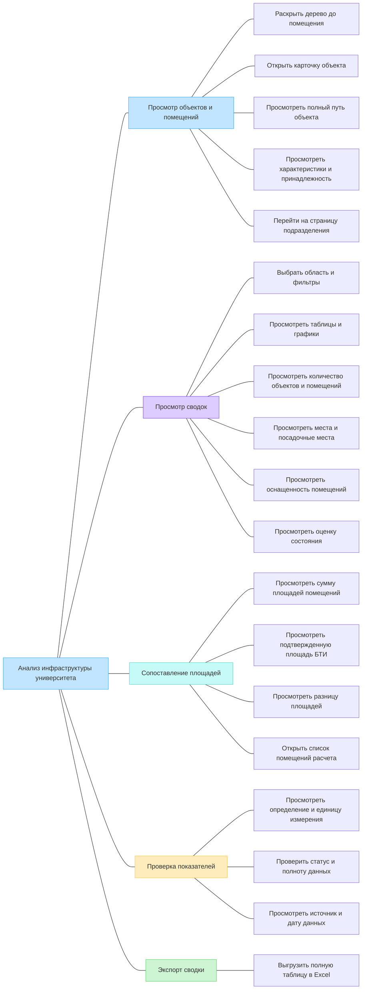

# Документ пользовательских требований

**Кейс:** BI Case — информационная система анализа инфраструктуры университета.  
**Команда:** Луконин Владимир Кириллович, Годенко Алексей Константинович.  
**Дата:** 05.11.2026.  
**Статус:** подготовлен раздел 1; план остальных частей — в [отдельном файле](План%20работы.md).

## 1. Реинжиниринг дерева функций

### 1.1. Основания и границы

Продолжается первый выпуск из лабораторной №1: просмотр инфраструктуры университета, расчёт доступных показателей и экспорт сводок. Бизнес-цели сохраняются:

- **BO-1:** сократить время поиска сведений о помещении не менее чем на 30% в течение месяца после первого выпуска.
- **BO-2:** сократить время подготовки сводки площадей, вместимости и оснащённости не менее чем на 50% за тот же период.
- **BO-3:** обеспечить объяснимость 100% показателей первого выпуска к технической приёмке: определение, единица, область расчёта, источник, статус, полнота и дата источника либо отметка, что она неизвестна.

| Источник | Что использовано |
|----------|------------------|
| [Концепция BI Case](<../../../lab1/variants/BI-Case/case_concept.md>), разделы 2–4 и 6; [RTM](<../../../lab1/variants/BI-Case/RTM.md>) | Цели, роли, функции, сценарии и границы первого выпуска |
| [BI.docx](<../../../archive/research_materials/BI.docx>), блоки 1–3 и 7 | Просмотр помещений, сводки, сопоставление площадей, качество данных и Excel |
| [structure.json](<../../../archive/research_materials/structure.json>) | Фактическая структура исходных данных; вхождения узла в разные ветви не означают разные физические объекты |
| [Методические рекомендации](<../../../archive/research_materials/НАДО СМОТРЕТЬ ПРИЛОЖЕНИ2 !!!Вх_от_Минздрав_России_№0054_от_14_01_2026_О_направлении_Методических.pdf>), приложение №2, страницы 71–72 PDF | Категории площадей, количества помещений и вместимости; показатели загрузки требуют дополнительных данных |
| [Реестр.xlsx](<../../../archive/research_materials/Реестр.xlsx>), листы «ОБЪЕКТЫ», «ПОМЕЩЕНИЯ», «Списки», «Пояснения» | Состав полей и варианты классификации; это форма реестра, а не заполненная инвентаризация |

Приложение №2 присутствует в PDF, хотя в конце `BI.docx` указано обратное. Наличие перечня показателей и полей реестра не подтверждает наличие данных для расчёта. Неизвестные значения не заменяются нулями; ограничения расчётов сохраняются из концепции.

### 1.2. Исходное дерево

Дерево перенесено из раздела 4.2 концепции без изменений.



### 1.3. Сверка с пользовательскими целями

Выделены пять эпиков. Каждый соответствует законченной цели пользователя. Действия внутри ветви остаются шагами сценария, если не имеют самостоятельного результата.

| ID | Пользовательское требование | Узел исходного дерева | Есть в дереве | Что сделано |
|----|-----------------------------|----------------------|---------------|-------------|
| EP-1 | Просмотреть сведения об объекте или помещении | Просмотр объектов и помещений | Да | Ветвь сохранена; навигация, путь, карточка и переход к подразделению входят в одну цель |
| EP-2 | Получить сводку по выбранной области | Просмотр сводок | Да | Ветвь сохранена; фильтры, показатели, таблицы и графики составляют результат одной сводки |
| EP-3 | Сопоставить площадь БТИ и площади помещений | Сопоставление площадей | Да | Ветвь сохранена; список учтённых помещений нужен для проверки сравнения |
| EP-4 | Проверить смысл и происхождение показателя | Проверка показателей | Да | Ветвь сохранена как самостоятельная цель проверки уже показанного значения |
| EP-5 | Выгрузить сводку в Excel | Экспорт сводки | Да | Ветвь сохранена; результат — файл с полной выбранной таблицей и параметрами расчёта |

Связи с первой лабораторной:

| Эпик | Основной инициатор | Бизнес-цель | Основание в концепции |
|------|--------------------|-------------|------------------------|
| EP-1 | Сотрудник хозяйственной службы | BO-1 | FE-1, FE-2; UC-1 |
| EP-2 | Аналитик, представитель руководства | BO-2, BO-3 | FE-3–FE-6; UC-9 |
| EP-3 | Специалист эксплуатации и БТИ | BO-2, BO-3 | FE-3, FE-6; UC-4, BR-9 |
| EP-4 | Аналитик | BO-3 | FE-6; ветвь «Проверка показателей»; отдельный сценарий будет оформлен в разделе 3 |
| EP-5 | Аналитик | BO-2, BO-3 | FE-7; UC-5, BR-11 |

Дополнительные роли из концепции используют эти же возможности в пределах своих прав. Представитель подразделения работает с разрешённой областью, комендант — с закреплёнными общежитиями. Аналитик может открыть исходную карточку для проверки сводки; это EP-1.

FE-8 — получение данных через API — обеспечивает выполнение эпиков. Авторизация, проверка прав, загрузка и обновление среза задают общие условия сценариев. Отдельная пользовательская цель управления API или первичным реестром в концепции не заявлена.

### 1.4. Скорректированное дерево

Состав ветвей и листьев сохранён. Названия пяти основных ветвей приведены к целям пользователей и связаны с ID эпиков. Новые функции не добавлены.

```text
Анализ инфраструктуры университета
├── EP-1. Просмотреть сведения об объекте или помещении
│   ├── Раскрыть дерево до помещения
│   ├── Открыть карточку объекта
│   ├── Просмотреть полный путь объекта
│   ├── Просмотреть характеристики и принадлежность
│   └── Перейти на страницу подразделения
├── EP-2. Получить сводку по выбранной области
│   ├── Выбрать область и фильтры
│   ├── Просмотреть таблицы и графики
│   ├── Просмотреть количество объектов и помещений
│   ├── Просмотреть места и посадочные места
│   ├── Просмотреть оснащенность помещений
│   └── Просмотреть оценку состояния
├── EP-3. Сопоставить площадь БТИ и площади помещений
│   ├── Просмотреть сумму площадей помещений
│   ├── Просмотреть подтвержденную площадь БТИ
│   ├── Просмотреть разницу площадей
│   └── Открыть список помещений расчета
├── EP-4. Проверить смысл и происхождение показателя
│   ├── Просмотреть определение и единицу измерения
│   ├── Проверить статус и полноту данных
│   └── Просмотреть источник и дату данных
└── EP-5. Выгрузить сводку в Excel
    └── Выгрузить полную таблицу в Excel
```

Определения и статусы доступны при просмотре сводки и сравнении площадей. EP-4 описывает отдельную цель пользователя — проверить конкретный показатель. Он не дублирует получение сводки EP-2 или сравнение EP-3.

### 1.5. Общие условия и исключения

Во всех эпиках соблюдаются правила BR-1–BR-11 концепции. Существенные условия:

- Учитываются только разрешённые пользователю объекты. Первичные записи не изменяются.
- Один физический объект учитывается в итоге один раз. Поддерживаются ветви разной глубины; отсутствие дочерних узлов само по себе не определяет помещение.
- Подтверждённый ноль, частичные данные, отсутствие данных и неприменимость различаются. Дата загрузки не подменяет дату источника.
- Площадь БТИ и сумма известных площадей помещений показываются раздельно. Разница рассчитывается при сопоставимости данных и не трактуется как свободная площадь.
- Таблица, графики и Excel используют одинаковые фильтры и версию данных. Экспорт охватывает все строки результата, включая строки за пределами текущей страницы.

Пожелания за рамками первого выпуска не получают ID эпиков:

| Пожелание | Решение | Основание в концепции |
|-----------|---------|------------------------|
| Фактическая загрузка всех категорий помещений | Вынесено за рамки: нет необходимых сведений о времени использования, посещениях или занятых местах | Разделы 6.2, 7.5, Q-13 |
| Финансовая эффективность, доходность и коммунальные индексы | Вынесено за рамки: нужны отдельные источники | Раздел 6.2 |
| Редактирование первичных сведений; автоматическое восстановление всех площадей | Вынесено за рамки: не определены ответственность и синхронизация; недостающие площади нельзя достоверно восстановить | Раздел 6.2 |
| Рейтинги цифровой зрелости, гендерная статистика, графики приёма и научные рейтинги | Вынесено за рамки: не относятся к целям первого выпуска или не имеют подтверждённой методики | Раздел 6.2 |
| Историческая динамика, публичный доступ и нативные мобильные приложения | Вынесено за рамки первого выпуска | Разделы 6.2–6.3 |
