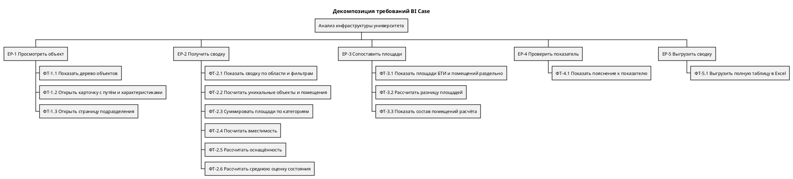

# Документ функциональных требований. Анализ инфраструктуры университета

**Вариант:** BI Case - анализ инфраструктуры университета.  
**Команда:** Луконин Владимир Кириллович, Годенко Алексей Константинович.  
**Дата:** 19.11.2026.  
**Основания:** [ЛР2, разделы 2.1, 3 и 7](<../../../lab2/variants/BI-Case/Документ пользовательских требований.md>), [концепция ЛР1, BR-1–BR-11 и AC-1–AC-14](../../../lab1/variants/BI-Case/case_concept.md), [материалы заказчика](../../../archive/research_materials/BI.docx).  
Схема декомпозиции - [исходник PlantUML](diagrams/decomposition.puml).



Функциональные точки посчитаны по упрощённой схеме IFPUG.

Группы данных учитываются один раз. Для них сложность определяется по DET и RET, числу логических подгрупп.

| Группа данных | Тип и сложность | FP | Где используется |
|---|---|---:|---|
| Р · Реестр инфраструктуры | EIF, средняя. 2 RET - сведения и вхождения в дерево. 20–50 DET - названия, площади, признаки оснащения, вместимость, пути и принадлежность | 7 | Все самостоятельные запросы |
| С · Сведения о сохранённом срезе | ILF, низкая. 1 RET, 4 DET - версия, источник, дата источника и время загрузки | 7 | Все самостоятельные запросы |
| М · Методика показателей | ILF, низкая. 1 RET, 7 DET - показатель, редакция, определение, единица, правило, уровни, условия применимости | 7 | ФТ-2.1, ФТ-3.1, ФТ-4.1, ФТ-5.1 |

Копия реестра использует те же логические данные Р. В С учтены только сведения о сохранённой версии. Контекст просмотра, рассчитанные значения и файл Excel формируются по запросу.

**Сумма по данным** - 21 FP.

## 1. Декомпозиция

Сохраняем идентификаторы историй EP-1–EP-5 из ЛР2. Все пять историй актуальны. Номер EP задаёт первую часть номера ФТ.

| История | Функциональные требования |
|---------|---------------------------|
| EP-1 Просмотреть объект | ФТ-1.1–ФТ-1.3 |
| EP-2 Получить сводку | ФТ-2.1–ФТ-2.6 |
| EP-3 Сопоставить площади | ФТ-3.1–ФТ-3.3 |
| EP-4 Проверить показатель | ФТ-4.1 |
| EP-5 Выгрузить сводку | ФТ-5.1 |

## 2. Спецификация

Система проверяет права просмотра и отдельно право экспорта. Дерево, путь, карточка, расчёты и Excel используют только разрешённые данные. При сбое источника система показывает сохранённый срез с предупреждением и временем последней успешной загрузки. Если подходящего среза нет, она сообщает об ошибке и предлагает повторить запрос. Сводка, пояснение и экспорт используют версию данных и редакцию методики открытого представления.

### ФТ-1.1

- **Формулировка** - Система должна показывать дерево доступных объектов.
- **История** - EP-1 (UC-1.1). **Актор** - сотрудник хозяйственной службы.
- **Вход** - выбранная ветвь и параметры страницы. **Результат** - разрешённые дочерние узлы с сохранённым путём.
- **Ошибка или ограничение** - Устаревший узел недоступен. Система предлагает вернуться к разрешённому родителю.
- **Приоритет** - Must. Дерево нужно, чтобы найти объект.

```text
Given: доступны корпус, клиническая база и общежитие с ветвями разной глубины.
When: сотрудник раскрывает группу или меняет страницу списка.
Then: видно разрешённые дочерние узлы, выбранный путь сохраняется.
```

**Оценка** - EQ, средняя. Р, С. 6–19 DET - узлы, названия, тип, путь, страница и версия. **4 FP, 5 предварительных поинтов.** Ветви разной глубины и права.

### ФТ-1.2

- **Формулировка** - Система должна открывать карточку с полным путём и характеристиками.
- **История** - EP-1 (UC-1.2–UC-1.4). **Актор** - сотрудник хозяйственной службы.
- **Вход** - выбранное вхождение объекта в дерево. **Результат** - карточка с названиями, путём, характеристиками, принадлежностью и источником.
- **Ошибка или ограничение** - Для неизвестного типа показывается «Тип не определён», для пропусков - «Нет данных».
- **Приоритет** - Must. Карточка и путь позволяют проверить нужный объект.

```text
Given: один объект виден в двух ветвях.
When: сотрудник открывает его во второй ветви.
Then: видны путь второй ветви, основное название и отличающееся название БТИ, характеристики,
      принадлежность и сведения об источнике. В карточке общежития виден комендант, если сведения
      подтверждены.
```

**Оценка** - EQ, высокая. Р, С. 20+ DET - путь, названия, площади, вместимость, оснащение, принадлежность и источник. **6 FP, 5 предварительных поинтов.** Один объект в нескольких ветвях, пропущенные поля.

### ФТ-1.3

- **Формулировка** - Система должна давать переход в подразделение по подтверждённой ссылке.
- **История** - EP-1 (UC-1.5). **Актор** - сотрудник хозяйственной службы.
- **Вход** - подтверждённая ссылка в карточке. **Результат** - страница указанного подразделения.
- **Ошибка или ограничение** - Без подтверждённого адреса ссылка скрыта.
- **Приоритет** - Could. Принадлежность уже видна в карточке.

```text
Given: в карточке подтверждены подразделение и его адрес.
When: сотрудник нажимает ссылку.
Then: открывается страница этого подразделения.
```

**Оценка** - EQ, в составе ФТ-1.2. URL уже получен в карточке. **0 FP, 2 предварительных поинтов.** Переход только по подтверждённой ссылке.

### ФТ-2.1

- **Формулировка** - Система должна показывать таблицу и предусмотренные графики по области и фильтрам.
- **История** - EP-2 (UC-9.1, UC-9.2). **Актор** - аналитик.
- **Вход** - область, фильтры, сортировка и параметры страницы. **Результат** - таблица, графики и итоги по одному срезу.
- **Ошибка или ограничение** - При недоступной области или неподдерживаемом фильтре система указывает причину и не выдаёт сводку по другой области.
- **Приоритет** - Must. Область и фильтры определяют содержание сводки.

```text
Given: аналитик открыл доступный этаж.
When: он задаёт фильтры по типу и подразделению, затем меняет сортировку и страницу.
Then: таблица и графики показывают один срез. Сортировка меняет порядок строк, смена страницы или её
      размера сохраняет итоги всей выборки.
```

**Оценка** - EO, высокая. Р, С, М. 20+ DET - контекст, поля строк, все группы показателей и их полнота. **7 FP, 8 предварительных поинтов.** Общий срез таблицы, графиков и итогов.

### ФТ-2.2

- **Формулировка** - Система должна считать уникальные объекты и помещения.
- **История** - EP-2 (UC-9.3). **Актор** - аналитик.
- **Вход** - область и записи с учётными ключами и типами. **Результат** - число уникальных объектов и помещений по подтверждённым категориям.
- **Ошибка или ограничение** - Конфликтующие повторы или неподтверждённая классификация блокируют затронутый итог с пояснением.
- **Приоритет** - Must. Количества нужны для сопоставления объектов.

```text
Given: две записи описывают один объект с подтверждённым учётным ключом.
When: аналитик открывает сводку по общей области.
Then: объект учтён один раз, помещения отнесены к подтверждённым категориям.
```

**Оценка** - EO, в составе ФТ-2.1. Поля количеств входят в сводку. **0 FP, 5 предварительных поинтов.** Устранение повторов и конфликты учётных записей.

### ФТ-2.3

- **Формулировка** - Система должна суммировать известные площади помещений по категориям.
- **История** - EP-2 (UC-4.1). **Актор** - аналитик.
- **Вход** - область, категория и площади помещений. **Результат** - сумма известных площадей с указанием полноты.
- **Ошибка или ограничение** - При отсутствии валидных площадей в непустой выборке показано «Нет данных». Итоги здания и этажей в сумму помещений не входят.
- **Приоритет** - Must. Сумма площадей входит в основную сводку.

```text
Given: площадь известна у 8 из 10 уникальных помещений одной категории.
When: аналитик открывает сводку.
Then: в сумму входят восемь известных площадей, показаны статус «Частичные данные» и охват 8 из 10.
```

**Оценка** - EO, в составе ФТ-2.1. Суммы по категориям входят в сводку. **0 FP, 5 предварительных поинтов.** Категории, уникальность и охват площадей.

### ФТ-2.4

- **Формулировка** - Система должна отдельно суммировать жилые и посадочные места.
- **История** - EP-2 (UC-9.4). **Актор** - аналитик.
- **Вход** - область и подтверждённые значения вместимости. **Результат** - отдельные суммы жилых и посадочных мест.
- **Ошибка или ограничение** - Без подтверждённого смысла поля расчёт по нему блокируется с пояснением.
- **Приоритет** - Must. Показатели нужны для сводки вместимости.

```text
Given: в выбранной области подтверждены 20 жилых и 30 посадочных мест.
When: аналитик открывает сводку.
Then: видны два отдельных итога - 20 и 30, с охватом при неполных данных.
```

**Оценка** - EO, в составе ФТ-2.1. Два показателя вместимости входят в сводку. **0 FP, 3 предварительных поинтов.** Раздельный учёт мест и неполных данных.

### ФТ-2.5

- **Формулировка** - Система должна рассчитывать оснащённость.
- **История** - EP-2 (UC-9.5). **Актор** - аналитик.
- **Вход** - область, признаки оснащённости и количество станций. **Результат** - доля по каждому признаку, охват и отдельная сумма станций.
- **Ошибка или ограничение** - При неизвестном знаменателе доля недоступна с пояснением. Правило применяется отдельно к каждому признаку.
- **Приоритет** - Must. Показатели нужны для сводки оснащённости.

```text
Given: для шести помещений указаны 3 «Да», 1 «Нет» и 2 неизвестных ответа о наличии кондиционера.
When: аналитик открывает сводку.
Then: доля составляет 75% с охватом 4 из 6. Мобильные компьютерные станции показаны отдельной суммой
      по уникальным помещениям.
```

**Оценка** - EO, в составе ФТ-2.1. Доли оснащённости и станции входят в сводку. **0 FP, 8 предварительных поинтов.** Разные знаменатели по признакам и пропуски.

### ФТ-2.6

- **Формулировка** - Система должна рассчитывать среднюю оценку состояния по согласованной шкале.
- **История** - EP-2 (UC-9.6). **Актор** - аналитик.
- **Вход** - область, оценки помещений и согласованная шкала. **Результат** - средняя валидная оценка и охват.
- **Ошибка или ограничение** - Без согласованной шкалы или валидных оценок система объясняет отсутствие результата.
- **Приоритет** - Should. Без средней оценки сводка полезна, но сравнить состояние объектов нельзя.

```text
Given: согласована шкала, в выборке есть оценки 2 и 4 и служебное значение.
When: аналитик открывает сводку.
Then: средняя оценка равна 3 по двум валидным оценкам, указан охват.
```

**Оценка** - EO, в составе ФТ-2.1. Средняя оценка входит в сводку. **0 FP, 3 предварительных поинтов.** Проверка шкалы и служебных значений.

### ФТ-3.1

- **Формулировка** - Система должна показывать отдельно подтверждённую площадь БТИ и сумму площадей помещений.
- **История** - EP-3 (UC-4.1, UC-4.2). **Актор** - специалист эксплуатации и БТИ.
- **Вход** - здание, фильтры, сведения БТИ и площади помещений. **Результат** - две отдельные площади с областями учёта, источниками и полнотой.
- **Ошибка или ограничение** - Неподтверждённое БТИ показано как «Нет данных». При фильтрах видна отобранная область.
- **Приоритет** - Must. Сравнение требует раздельных исходных площадей.

```text
Given: доступны подтверждённые 1 000 м² БТИ здания и 900 м² по помещениям.
When: специалист открывает сопоставление.
Then: обе площади показаны отдельно вместе с областями учёта, фильтрами, источниками, датами и
      полнотой. Сумма считается по правилу ФТ-2.3.
```

**Оценка** - EO, средняя. Р, С, М. 18 DET по расчёту ниже. **5 FP, 5 предварительных поинтов.** Проверка происхождения БТИ и повторное использование суммы.

#### Расчёт функциональных точек для ФТ-3.1 и ФТ-3.2

1. Запрос сопоставления выдаёт расчёт, поэтому это EO.
2. Он читает реестр Р, сведения о срезе С и методику М, FTR = 3.
3. Поля - здание, два фильтра, область учёта БТИ, две площади, разница в м² и процентах, единица измерения, статус и охват суммы, два источника и их даты, версия данных и редакция методики. DET = 17 + 1 сообщение = 18.
4. По матрице EO это средняя сложность и 5 FP. Разница из ФТ-3.2 входит в эти 5 FP.

### ФТ-3.2

- **Формулировка** - Система должна рассчитывать разницу для сопоставимых площадей.
- **История** - EP-3 (UC-4.3). **Актор** - специалист эксплуатации и БТИ.
- **Вход** - площадь БТИ и сумма площадей помещений с их областями учёта. **Результат** - разница в м² и, при положительной площади БТИ, в процентах.
- **Ошибка или ограничение** - При несопоставимых областях или отсутствующей площади разница скрыта с пояснением. При БТИ = 0 процент скрыт. При допустимом расчёте по частичной сумме сама разница помечена как частичная с указанием охвата.
- **Приоритет** - Must. Разница нужна для выявления расхождения, когда сравнение допустимо.

```text
Given: подтверждены 1 000 м² БТИ и полная сопоставимая сумма 900 м².
When: специалист запрашивает сопоставление.
Then: показана разница 100,00 м² и 10%, без промежуточного округления.
```

**Оценка** - EO, в составе ФТ-3.1. Поля разницы уже учтены. **0 FP, 8 предварительных поинтов.** Сопоставимость областей и частичная сумма.

### ФТ-3.3

- **Формулировка** - Система должна показывать список помещений, по которым проверяется сумма.
- **История** - EP-3 (UC-4.4). **Актор** - специалист эксплуатации и БТИ.
- **Вход** - запрос списка для открытого сравнения. **Результат** - помещения той же выборки с путями и площадями либо статусами.
- **Ошибка или ограничение** - Если состав этого среза недоступен, система сообщает причину и не показывает список другой версии.
- **Приоритет** - Must. Без списка нельзя проверить, какие помещения вошли в выборку.

```text
Given: открыто сравнение по отфильтрованному составу помещений.
When: специалист запрашивает состав расчёта.
Then: видны помещения той же выборки, их пути, площади или статус «Нет данных». Из списка можно
      открыть доступную карточку.
```

**Оценка** - EQ, средняя. Р, С. 6–19 DET - здание, фильтры, версия, помещение, путь, площадь и статус. **4 FP, 3 предварительных поинтов.** Список по тому же составу и версии.

### ФТ-4.1

- **Формулировка** - Система должна показывать определение, единицу, правило и область расчёта, статус, охват, источник и его дату для выбранного показателя.
- **История** - EP-4 (UC-10.1–UC-10.3). **Актор** - аналитик.
- **Вход** - показатель и контекст открытого представления. **Результат** - пояснение с определением, правилом, областью, статусом, охватом и сведениями об источнике.
- **Ошибка или ограничение** - Неизвестная дата обозначена явно. Если нужная версия пояснения недоступна, система предлагает обновить исходное представление.
- **Приоритет** - Must. Без этих сведений нельзя проверить пригодность показателя.

```text
Given: на экране есть частичный показатель, а редакция методики после открытия поменялась.
When: аналитик открывает пояснение.
Then: видит определение, единицу, правило и область расчёта из открытого контекста, статус с
      причиной и охватом, источник и его дату. Время загрузки показано отдельно.
```

**Оценка** - EQ, средняя. Р, С, М. 6–19 DET - контекст, определение, единица, правило, охват, статус, источник и даты. **4 FP, 5 предварительных поинтов.** Пояснение должно совпадать с открытой редакцией.

### ФТ-5.1

- **Формулировка** - Система должна выгружать полную таблицу в Excel с параметрами и пояснениями к показателям.
- **История** - EP-5 (UC-5). **Актор** - аналитик.
- **Вход** - открытая сводка с областью, фильтрами, сортировкой и версиями. **Результат** - файл Excel с полными данными и листом параметров.
- **Ошибка или ограничение** - При пустой выборке система сообщает об этом и выдаёт файл с заголовками и параметрами. При отказе в доступе, отсутствии нужной версии или ошибке формирования файл не выдаётся.
- **Приоритет** - Must. Файл нужен для продолжения анализа в Excel.

```text
Given: у аналитика есть право экспорта и открыта вторая страница отсортированной сводки.
When: он выбирает «Выгрузить в Excel».
Then: файл содержит все разрешённые строки в экранном порядке и лист параметров с областью,
      фильтрами, версиями и пояснениями. Известные величины выгружены числами с единицами в
      заголовках, неизвестные - пустыми числовыми ячейками с отдельным статусом. Исходный текст
      сохранён как текст, реквизиты доступа исключены.
```

**Оценка** - EO, высокая. Р, С, М. 20+ DET - поля сводки и листа параметров. Полная выборка рассчитывается по закреплённым версиям. **7 FP, 13 предварительных поинтов.** Все страницы, порядок строк, версии, типы ячеек и обработка сбоев.

### 2.1. Значения и границы расчётов

| ФТ | Какие значения и уровни используются | Поведение на границе |
|---|---|---|
| ФТ-1.1–ФТ-1.3 | Организация, группа, здание, этаж или блок, помещение. Ветви собственных зданий, клинических баз и общежитий могут иметь разную глубину. | Тип определяется по согласованной классификации. Узел без дочерних элементов сам по себе не считается помещением. При одинаковых названиях выводится только основное. Принадлежность и переход показываются по подтверждённой связи. |
| ФТ-2.1 | Сводка доступна для организации, группы, здания и этажа или блока. В карточке помещения видны его собственные характеристики. Фильтры по типу и подразделению доступны при подтверждённых связях. | Статус «Неприменимо» используется для показателя, предусмотренного профилем, если он неприменим к объекту. Показатели вне профиля в сводку не включаются. Площади клинических баз и общежитий учитываются по согласованным категориям. |
| ФТ-2.2, ФТ-2.4, ФТ-2.5 | Объекты и помещения, жилые места, посадочные места и мобильные станции считаются раздельно, в целых неотрицательных единицах. | Для подтверждённой пустой категории количество равно 0. Итоги по местам и станциям используют подтверждённые значения без повторного учёта родительских итогов. Без подтверждённого состава или смысла поля показывается ограничение. |
| ФТ-2.3, ФТ-3.1 | Площади - неотрицательные числа в м². Категории помещений - учебные, лабораторные, жилые, спортивные, медицинские, административные, коммерческие и общего пользования. Сумма каждой категории включает только известные площади уникальных помещений. | `5 026,6` читается как 5026,6. Некорректное значение считается неизвестным. Для подтверждённой пустой категории сумма равна 0. Площадь БТИ показывается при подтверждённых происхождении, составе и единице. Для этажа нужно отдельное подтверждённое значение БТИ. |
| ФТ-2.5 | Для кондиционера, жалюзи, сейфа, мультимедиа и средств доступности отдельно считаем `число «Да» / число известных ответов × 100%`. Допустимая доля - от 0 до 100% включительно. | Если все известные ответы «Нет», доля равна 0%. Если все «Да» - 100%. При нулевом или неизвестном знаменателе доля отсутствует. Пропуск остаётся неизвестным до подтверждения трактовки поля. |
| ФТ-2.6 | Среднее считается по валидным значениям одной согласованной шкалы и лежит в её пределах. Служебные значения исключаются. | Без согласованной шкалы или при отсутствии валидных оценок результат недоступен. Числа 2 и 4 в сценарии - пример приёмки. Границы шкалы ещё не утверждены. |
| ФТ-3.2, ФТ-3.3 | Для сопоставимого состава `Δ = площадь БТИ − сумма площадей помещений`. При БТИ больше 0 `Δ% = Δ / площадь БТИ × 100%`. Разница может быть отрицательной, нулевой или положительной. Относительная разница не превышает 100%. | При БТИ = 0, если состав сопоставим, показывается только разница в м². Если фильтр сузил состав комнат, для разницы нужна площадь БТИ той же области. Разницу нельзя использовать как показатель свободной площади. Площади показываются с двумя знаками после запятой. |
| ФТ-4.1, ФТ-5.1 | «Рассчитано» - все нужные значения известны. «Частичные данные» - доступна часть значений и допустим расчёт по ней. «Нет данных» - валидных значений нет или расчёт заблокирован. Подтверждённый 0 - числовое значение. | Охват записывается как `k из N`, где `k` - число объектов с известным значением поля, `N` - число подходящих уникальных объектов выборки, `0 ≤ k ≤ N`. Это полнота заполнения полей реестра. Неизвестная дата источника помечается явно. Время загрузки показывается отдельно. |

Вопросы к владельцу данных остаются открытыми по Q-2–Q-4, Q-6, Q-8–Q-10 и Q-12 из ЛР1. Они определяют классификацию и ключ объекта, значения `-1`, пустого поля и `0` в каждом атрибуте, состав БТИ, связи, шкалу состояния и трактовку мест и станций. До подтверждения система показывает доступные сведения и причину, по которой затронутый показатель нельзя посчитать. Точные параметры страниц и глубины выдачи относятся к контракту API из Q-7.

## 3. Схема

В [исходнике PlantUML](diagrams/decomposition.puml) указаны те же истории и функции, что в разделах 1 и 2.

## 4. Сводка оценок

**Функциональные точки.** Считаем самостоятельные запросы без записи в хранилище. EQ читает данные, EO выдаёт расчёт. DET - разные пользовательские поля на входе и выходе плюс одно поле для сообщения. FTR - разные группы данных, которые читает процесс. Сложность и вес берём из [матриц учебного примера](<../../example/Документ функциональных требований.md#ft-1-3-fp>). Поля для сортировки, пагинации и варианты одного показателя входят в соответствующий запрос. Функция внутри уже оценённого запроса получает 0 **дополнительных** точек.

**Протокол оценок.** Командного раунда пока не было. Роли из ЛР2 - аналитик Владимир Луконин, разработчик Алексей Годенко (предложен), тестировщик Владимир Луконин (предложен). Предварительные поинты поставлены по шкале 1, 2, 3, 5, 8, 13, 21. Карты аналитика, разработчика и тестировщика пока пусты (- / - / - для всех ФТ). Итог раунда будет записан после командной оценки.

| ID | Тип | Точки | Поинты |
|----|-----|------:|-------:|
| ФТ-1.1 | EQ, средняя | 4 | 5 |
| ФТ-1.2 | EQ, высокая | 6 | 5 |
| ФТ-1.3 | EQ, в составе ФТ-1.2 | 0 | 2 |
| ФТ-2.1 | EO, высокая | 7 | 8 |
| ФТ-2.2 | EO, в составе ФТ-2.1 | 0 | 5 |
| ФТ-2.3 | EO, в составе ФТ-2.1 | 0 | 5 |
| ФТ-2.4 | EO, в составе ФТ-2.1 | 0 | 3 |
| ФТ-2.5 | EO, в составе ФТ-2.1 | 0 | 8 |
| ФТ-2.6 | EO, в составе ФТ-2.1 | 0 | 3 |
| ФТ-3.1 | EO, средняя | 5 | 5 |
| ФТ-3.2 | EO, в составе ФТ-3.1 | 0 | 8 |
| ФТ-3.3 | EQ, средняя | 4 | 3 |
| ФТ-4.1 | EQ, средняя | 4 | 5 |
| ФТ-5.1 | EO, высокая | 7 | 13 |
| Общие данные | EIF 7 + ILF 7 + ILF 7 | 21 | |

**Итого:** 37 FP за запросы + 21 FP за группы данных = **58 FP**. Сумма предварительных оценок - **78 поинтов**.

## 5. Матрица

Строки EP содержат суммы по функциям. Общие 21 FP за группы данных относятся к системе в целом. Колонка НФТ оставлена для ЛР4.

| ID | Тип | Источник | Связанные ФТ | Приоритет | Критерий приёмки | FP | Поинты | НФТ |
|---|---|---|---|---|---|---:|---:|---|
| EP-1 | История | Хозяйственная служба, UC-1 | ФТ-1.1–ФТ-1.3 | Must | Нужная карточка открывается с путём выбранной ветви | 10 | 12 | |
| ФТ-1.1 | Функция | EP-1, UC-1.1 | | Must | Дерево раскрывается до доступного помещения | 4 | 5 | |
| ФТ-1.2 | Функция | EP-1, UC-1.2–UC-1.4 | | Must | Путь и характеристики верны, одинаковые названия не повторяются | 6 | 5 | |
| ФТ-1.3 | Функция | EP-1, UC-1.5 | | Could | Подтверждённая ссылка открывает нужное подразделение | 0 | 2 | |
| EP-2 | История | Аналитик, UC-9 | ФТ-2.1–ФТ-2.6 | Must | Сводка показывает выбранную область и полноту расчёта | 7 | 32 | |
| ФТ-2.1 | Функция | EP-2, UC-9.1, UC-9.2 | | Must | Сортировка и пагинация сохраняют итог и версии | 7 | 8 | |
| ФТ-2.2 | Функция | EP-2, UC-9.3 | | Must | Повтор объекта учитывается один раз | 0 | 5 | |
| ФТ-2.3 | Функция | EP-2, UC-4.1 | | Must | Частичная сумма сопровождается охватом | 0 | 5 | |
| ФТ-2.4 | Функция | EP-2, UC-9.4 | | Must | Жилые и посадочные места подсчитаны раздельно | 0 | 3 | |
| ФТ-2.5 | Функция | EP-2, UC-9.5 | | Must | Доля рассчитана по известным ответам, станции показаны отдельно | 0 | 8 | |
| ФТ-2.6 | Функция | EP-2, UC-9.6 | | Should | Средняя оценка использует валидные значения одной шкалы | 0 | 3 | |
| EP-3 | История | Эксплуатация и БТИ, UC-4 | ФТ-3.1–ФТ-3.3 | Must | Площади показаны отдельно, состав сравнения доступен | 9 | 16 | |
| ФТ-3.1 | Функция | EP-3, UC-4.1, UC-4.2 | | Must | Видны две площади и их области учёта | 5 | 5 | |
| ФТ-3.2 | Функция | EP-3, UC-4.3 | | Must | 1 000 и 900 м² дают 100 м² и 10% при сопоставимом составе | 0 | 8 | |
| ФТ-3.3 | Функция | EP-3, UC-4.4 | | Must | Помещения и площади соответствуют выборке расчёта | 4 | 3 | |
| EP-4 | История | Аналитик, UC-10 | ФТ-4.1 | Must | Показатель можно проверить в открытом контексте | 4 | 5 | |
| ФТ-4.1 | Функция | EP-4, UC-10.1–UC-10.3 | | Must | Пояснение содержит определение, источник, дату, статус и охват | 4 | 5 | |
| EP-5 | История | Аналитик, UC-5 | ФТ-5.1 | Must | Excel воспроизводит полную выборку и параметры | 7 | 13 | |
| ФТ-5.1 | Функция | EP-5, UC-5 | | Must | Строки всех страниц, порядок, статусы и версии совпадают со сводкой | 7 | 13 | |

## 6. Выводы

Среди запросов больше всего FP у сводки и Excel - по 7, поскольку оба работают с тремя группами данных и выводят много полей. По предварительным поинтам дороже всего Excel - 13 из-за восстановления полной выборки, сохранения контекста и проверки файла. Сравнение площадей тоже требует заметной работы из-за правил сопоставимости, хотя ФТ-3.2 уже учтена в точках ФТ-3.1.

В ближайший выпуск входят все Must. Оценку состояния добавляем при согласованной шкале. Переход по ссылке на подразделение можно перенести на следующий выпуск. Фактическая загрузка помещений, восстановление пропущенных площадей, финансовая и историческая аналитика остаются за рамками первого выпуска по разделу 6.2 концепции ЛР1.
